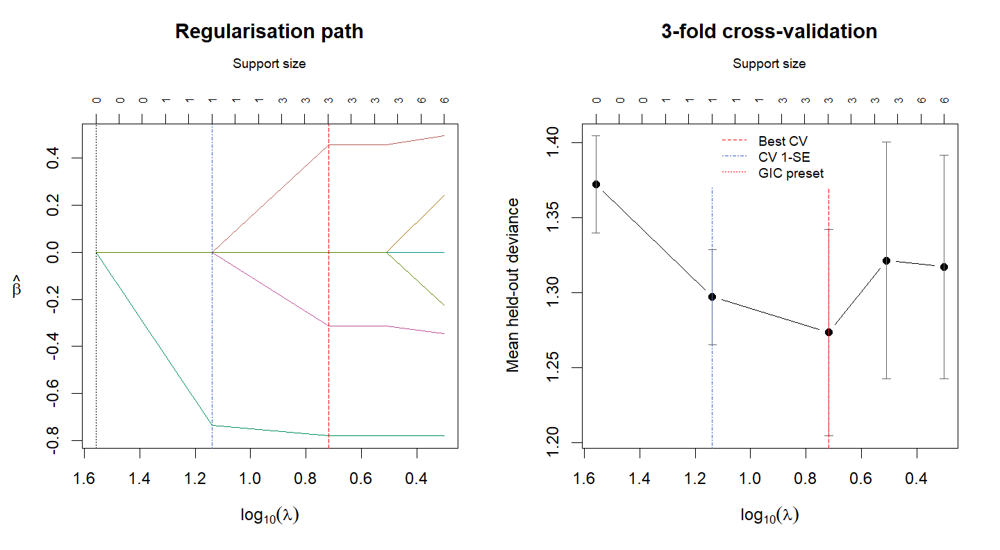
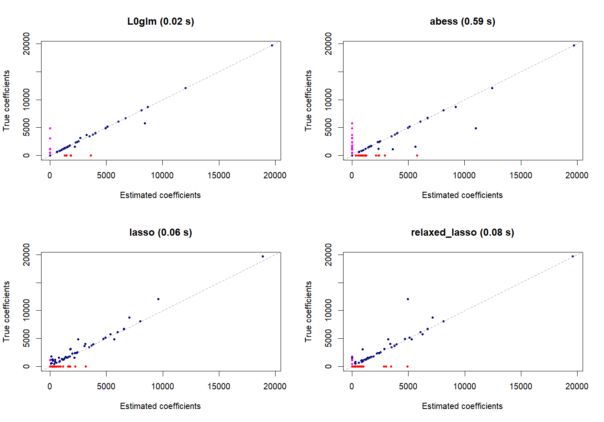
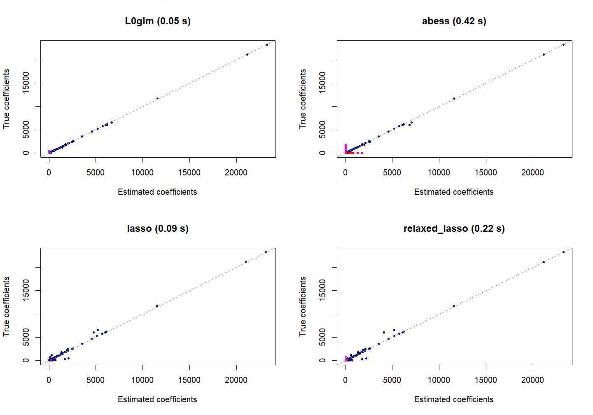
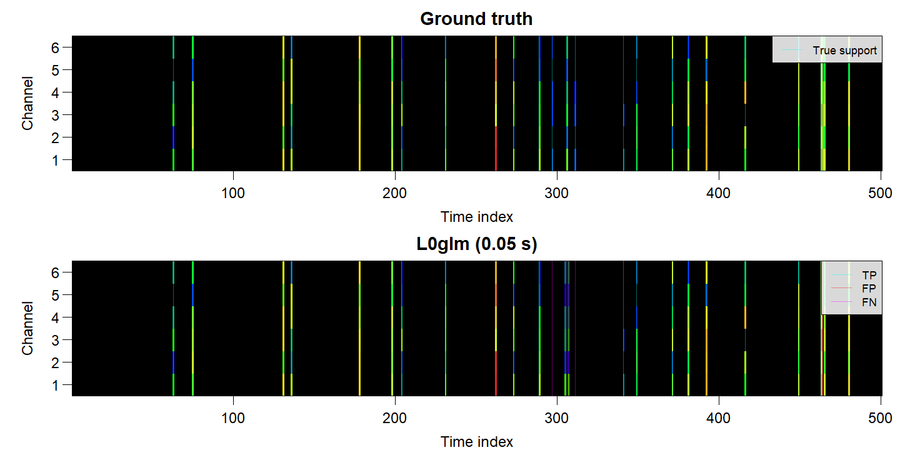
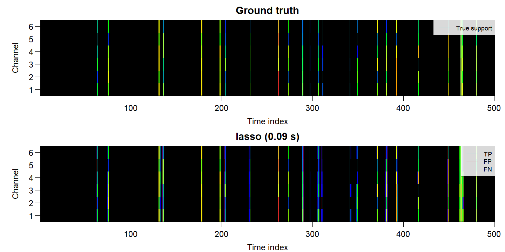

<!-- README.md is generated from README.Rmd. Run Rscript benchmarks/render_readme.R. -->

# L0glm: fast sparse regression for generalized linear models

`L0glm` fits **L0-penalized and grouped L0-penalized models** for best subset and
best subset of groups selection. It combines adaptive ridge with IRLS, fast
linear solvers and an optional relaxed refit to obtain sparse, low-bias estimates.
The method is a subset-selection heuristic, rather than a certified global optimizer.

- **Families:** standard GLMs and their links, negative binomial with estimated
  shape, joint multinomial logistic regression, and right-censored Cox PH.
- **Data:** dense or sparse, tall or wide designs; single or multiple responses;
  grouped row selection; SIS/ISIS screening for ultrahigh dimensions.
- **Controls:** observation weights, offsets, unpenalized terms, starting values,
  normalization, original-scale coefficients and optional nonnegativity constraints.
- **Selection:** a fast GIC preset, information-criterion path selection, or
  cross-validation with minimum-deviance and one-standard-error models.
- **Comparison:** `sparseglm()` benchmarks L0glm, ABESS, L0Learn, LASSO, relaxed
  and adaptive LASSO, MCP and SCAD where their backends support the requested model.

A preset can avoid a costly regularization search, while a shrinking active set
and compiled solvers reduce fitting work. L0 selection followed by a relaxed
refit can also reduce shrinkage and false positives relative to LASSO. The
benchmarks below report both speed and support recovery against competing methods;
the advantage depends on the design, signal and tuning rule.

## Installation

```r
install.packages("remotes")
remotes::install_github("tomwenseleers/L0glm", subdir="L0glm")
```

The source package is in `L0glm/`. Windows source installation requires
[Rtools](https://cran.r-project.org/bin/windows/Rtools/).
The special-family examples use `mgcv`; Cox also uses `survival`.

## Fit and tune

For one response, the target is `-2 * logLik + lambda * number_of_nonzero_coefficients`.
Grouped selection instead charges selected predictor rows. `lambda="gic"` uses
`log(p) * log(log(n))`; AIC, BIC, EBIC and MBIC presets are also available.
`L0glm.tune(tune="gic")` searches a path using GIC, whereas `tune="cv"` minimizes
held-out deviance. The following small helper shows both workflows for every
example, using five lambda values and three folds; increase these for a finer search.

``` r
library(L0glm)

tune_both <- function(X, y, family, foldid=NULL, plot_cv=FALSE, ...) {
  lapply(c(gic="gic", cv="cv"), function(rule)
    L0glm.tune(X, y, family=family, tune=rule, nlambda=5, nfolds=3,
      foldid=if (rule=="cv") foldid else NULL,
      plot=(rule=="cv" && plot_cv), printbest=FALSE, ...))
}

set.seed(1)
X <- matrix(rnorm(300*20), 300, 20)
y <- rbinom(300, 1, plogis(.8*X[, 1] - .6*X[, 2]))
fit <- L0glm.fit(X, y, family=binomial(), lambda="gic",
  relaxed=TRUE, maxit=100)
tuned <- tune_both(X, y, binomial(), relaxed=TRUE, maxit=100, plot_cv=TRUE)
```

<div class="figure">

<p class="caption">Binomial coefficient paths and three-fold validation deviance.</p>
</div>

``` r
coef(tuned$gic$fit_best)[1:3, , drop=FALSE]  # intercept and first two slopes
#> 3 x 1 sparse Matrix of class "dgCMatrix"
#>
#> Intercept  0.0024
#>            0.4552
#>           -0.7801
predict(tuned$cv$fit_1se, X[1:3, , drop=FALSE], type="response")
#>       [,1]
#> [1,] 0.347
#> [2,] 0.689
#> [3,] 0.194
```

CV returns `lambda_best`, `lambda_1se`, `fit_best` and `fit_1se`; both fits use
all observations. The graph shows mean validation deviance ± one SE. Folds hold
out whole rows, including all response channels. Preprocessing, screening and
nuisance-parameter estimation use training rows only; the common lambda grid
uses full data. CV used for tuning is not an independent test of prediction error.

## Negative binomial, multinomial and Cox models

These simulations each have only two active predictors out of twenty. They share
the same design and reproducible random folds.

``` r
set.seed(204)
n <- 300L
X_special <- matrix(rnorm(n*20), n, 20)
folds <- sample(rep(1:3, length.out=n))
```

**Negative binomial:** `mgcv::nb()` estimates the NB2 shape parameter theta
alongside the coefficients. Use `mgcv::nb(theta=2)` to keep it fixed.

``` r
mu <- exp(.4 + .8*X_special[, 1] - .6*X_special[, 2])
y_nb <- rnbinom(n, mu=mu, size=2)
nb <- tune_both(X_special, y_nb, mgcv::nb(), intercept=TRUE,
  foldid=folds, relaxed=TRUE, maxit=100, tol=1e-8)
nb$gic$fit_best$theta
predict(nb$cv$fit_1se, X_special[1:3, , drop=FALSE], type="response")
```

**Multinomial:** three categories, joint likelihood and grouped predictor-row
selection. The returned coefficients are zero-sum CLR contrasts; predictions are
probabilities. Factor responses or category-count matrices are accepted.

``` r
eta <- cbind(0, .9*X_special[, 1] - .7*X_special[, 2],
  -.8*X_special[, 1] + .6*X_special[, 2])
prob <- exp(eta - apply(eta, 1, max))
prob <- prob/rowSums(prob)
y_class <- factor(vapply(seq_len(n), function(i)
  sample.int(3, 1, prob=prob[i, ]), integer(1)), levels=1:3)
multinomial <- tune_both(X_special, y_class, mgcv::multinom(K=2),
  foldid=folds, grouped=TRUE, relaxed=TRUE, maxit=200, tol=1e-8)
predict(multinomial$cv$fit_1se, X_special[1:3, , drop=FALSE], type="response")
```

**Cox PH:** right censoring, Breslow ties and no identifiable intercept. Small
dense systems use Cholesky; large systems can use cached matrix-free PCG.
CV uses full-risk-set partial-likelihood subtraction.

``` r
event <- rexp(n, rate=exp(.7*X_special[, 1] - .5*X_special[, 2]))
censor <- rexp(n, rate=.4)
y_surv <- survival::Surv(pmin(event, censor), event <= censor)
cox <- tune_both(X_special, y_surv, mgcv::cox.ph(), foldid=folds,
  relaxed=TRUE, maxit=100, tol=1e-8)
predict(cox$cv$fit_1se, X_special[1:3, , drop=FALSE], type="risk")
```

## One million predictors: SIS/ISIS screening

`screen="SIS"` performs a single marginal screen; `screen="ISIS"` repeatedly
screens against the current model using offsets and retains the best GIC round.
`screen="auto"` enables ISIS for ultrahigh-dimensional designs; `screen="none"`
disables screening. Screening is a heuristic and can miss signals.

This is the 500-observation, one-million-predictor Gaussian benchmark, with 60
positive or negative effects. **The dense design alone needs about 4 GB RAM**;
set `p <- 20000L` for a quick run. This is an in-memory example.

``` r
n <- 500L
p <- 1000000L
set.seed(123)
X_hd <- matrix(rnorm(n*p), n, p)
active <- sample.int(p, 60L)
beta_hd <- numeric(p)
beta_hd[active] <- runif(60L, -.8, .8)
set.seed(1)
y_hd <- as.numeric(X_hd[, active] %*% beta_hd[active]) + rnorm(n)
```

Compare GIC-preset ISIS plus L0glm with BIC-selected LASSO and relaxed LASSO:

``` r
comparison_hd <- sparseglm(X_hd, y_hd, family=gaussian(),
  method=c("L0glm", "lasso", "relaxed_lasso"), tune="bic", nlambda=40,
  intercept=FALSE, beta_true=beta_hd,
  lambda=list(L0glm=log(p)*log(log(n))),
  options=list(L0glm=list(screen="ISIS", screen.nthreads=8, nthreads=1,
    relaxed=TRUE)))
fields <- c("method", "seconds", "support_size_estimated", "gic", "F1_score", "MCC")
hd_scores <- L0glm.metrics(comparison_hd)
hd_scores$selection <- c("GIC preset", "BIC path", "BIC path")
hd_scores[fields]
```

|Method        |Selection  | Seconds| Selected|   GIC|    F1|   MCC|
|:-------------|:----------|-------:|--------:|-----:|-----:|-----:|
|L0glm         |GIC preset |    3.67|       43|  2583| 0.777| 0.787|
|lasso         |BIC path   |   26.74|      635| 14789| 0.066| 0.118|
|relaxed_lasso |BIC path   |  114.97|      474| 10588| 0.079| 0.124|

In this run, ISIS plus L0glm is **7.3 times faster than LASSO**.
The L0glm timing includes ISIS and one GIC-preset fit; LASSO methods include up
to 40 native path values, BIC selection and any relaxed refits. BIC is used for
LASSO because GIC can select a null model at this dimension. The GIC column is
still a common evaluation score for all methods. For CV-selected LASSO, use
`tune="cv", nfolds=5` in the comparison call. Timings
exclude simulation, use one BLAS thread, and allow eight screening threads.
These compare practical workflows, not equal numbers of fitted models.
F1/MCC assess recovery of the known support; true coefficients never guide fitting.
MCC is undefined (`NA`) for a constant estimated support, including a null model.

Both GIC path selection and CV can also be combined with screening:

``` r
hd <- tune_both(X_hd, y_hd, gaussian(), screen="ISIS", screen.nthreads=8,
  nthreads=1, relaxed=TRUE)          # screening is repeated within each CV fold
dim(coef(hd$cv$fit_1se))             # 1000000 x 1, including screened-out zero rows
L0glm.metrics(hd$cv$fit_1se, beta_true=beta_hd)[c("gic", "F1_score", "MCC")]
```

## Application: sparse Poisson deconvolution

A convolution design contains shifted copies of a known point-spread function.
Nonnegative identity-link Poisson regression estimates the underlying spike
train. Multiple channels can share selected peak locations while retaining
different amplitudes and within-row sparsity.

### Single channel

``` r
single <- simul(method=2, n=500, p=500, s=.1, seed=2)
fit_single <- L0glm.fit(single$X, single$y, family=poisson(identity),
  lambda="gic", nonnegative=TRUE, relaxed=TRUE, parallelize=FALSE)
single_tuned <- tune_both(single$X, single$y, poisson(identity),
  nonnegative=TRUE, relaxed=TRUE, parallelize=FALSE, prop_range=.25,
  foldid=rep(1:3, length.out=500))
methods <- c("L0glm", "abess", "lasso", "relaxed_lasso")
comparison_single <- sparseglm(single, family=poisson(identity),
  method=methods, tune="gic", nlambda=10, support.size=1:100,
  nonnegative=TRUE, intercept=FALSE, approximation="wls",
  lambda=list(L0glm=fit_single$init.lambda),
  options=list(L0glm=list(relaxed=TRUE, parallelize=FALSE)))
L0glm.metrics(comparison_single)[fields]
```

|Method        | Seconds| Selected|  GIC|    F1|   MCC|
|:-------------|-------:|--------:|----:|-----:|-----:|
|L0glm         |    0.02|       48| 4824| 0.878| 0.864|
|abess         |    0.59|       47| 7616| 0.639| 0.601|
|lasso         |    0.06|      136| 6001| 0.516| 0.515|
|relaxed_lasso |    0.08|       76| 5323| 0.714| 0.694|

``` r
plot(comparison_single)
```

<div class="figure">

<p class="caption">Single-channel spike amplitudes: L0glm, ABESS, LASSO and relaxed LASSO.</p>
</div>

### Multiple channels

``` r
multi <- simul(method=4, n=500, p=500, s=.05, seed=2)
keep <- head(order(colSums(multi$y), decreasing=TRUE), 6)
for (name in c("y", "y_true", "beta_true"))
  multi[[name]] <- multi[[name]][, keep, drop=FALSE]
multi_tuned <- tune_both(multi$X, multi$y, poisson(identity),
  nonnegative=TRUE, grouped=TRUE, relaxed=TRUE, parallelize=FALSE,
  prop_range=.25, foldid=rep(1:3, length.out=500))
comparison_multi <- sparseglm(multi, family=poisson(identity),
  method=methods, tune="gic", nlambda=10, support.size=1:50,
  nonnegative=TRUE, intercept=FALSE, approximation="wls_grouped",
  lambda=list(L0glm=multi_tuned$gic$lambda_preset),
  options=list(L0glm=list(relaxed=TRUE, parallelize=FALSE)))
L0glm.metrics(comparison_multi)[c(fields, "within_row_MCC")]
```

|Method        | Seconds| Rows|   GIC| Row F1| Row MCC| Within-row MCC|
|:-------------|-------:|----:|-----:|------:|-------:|--------------:|
|L0glm         |    0.05|   23| 13819|  0.875|   0.870|          1.000|
|abess         |    0.42|   23| 15197|  0.750|   0.738|          1.000|
|lasso         |    0.09|   46| 15361|  0.704|   0.721|          0.634|
|relaxed_lasso |    0.22|   34| 14118|  0.814|   0.813|          0.574|

``` r
plot(comparison_multi, channels="all")
```

<div class="figure">

<p class="caption">True versus estimated coefficients across all six response channels.</p>
</div>

``` r
par(mar=c(3, 4, 2, 1), mgp=c(2, .7, 0))
plot(comparison_multi, type="heatmap", which=c(1, 3))  # L0glm and LASSO
```

<div class="figure">

<p class="caption">Ground truth and L0glm multichannel deconvolution.</p>
</div><div class="figure">

<p class="caption">Ground truth and group LASSO multichannel deconvolution.</p>
</div>

All methods are scored with the original Poisson likelihood. L0glm fits that
model directly; competitors use labelled Gaussian WLS approximations:
`1/(y+0.1)` for one channel, or shared row weights `1/(rowMeans(Y)+0.1)` for
grouped multichannel fitting. ABESS searches consecutive support sizes with
warm starts; glmnet searches ten lambda values. L0glm uses one GIC preset.
Timings include each method's fitting and selection, but not the separate
illustrative L0glm tuning calls.

In coefficient plots, navy marks true positives, red false positives and
magenta false negatives. Heatmaps use cyan support/true-positive lines, red
false-positive lines and magenta false-negative lines. Row F1/MCC measure peak
selection; within-row MCC measures spectral sparsity among correctly recovered
rows. Interleaved CV folds hold out every third time point across all channels;
these assess interpolation within a trace, not prediction on a new chromatogram.
Use `prop_range=1` for the full lambda range instead of the illustrated zoom.

## Practical notes and further examples

- Defaults are `maxit=25, tol=1e-10`; inspect convergence and increase `maxit`
  for difficult models. The examples explicitly allow more iterations where needed.
- Coefficients are returned on the original scale. `normalize="auto"` scales
  signed designs and preserves peak-one nonnegative deconvolution designs.
- Nonnegative Poisson identity-link fits use the compiled `L0nnpois` backend
  when eligible. Set `openmp=FALSE` to use the general R implementation.
- `predict()`, `fitted()`, `summary()`, `logLik()`, `AIC()`, `BIC()` and
  `L0glm.metrics()` provide predictions, diagnostics and common fit/recovery scores.
- `sparseglm(method="all")` includes installed compatible methods; unsupported
  explicitly requested combinations retain explanatory status rows. Estimated-theta
  NB comparisons are not yet implemented; use `L0glm.fit()`/`L0glm.tune()` directly.
- `simul()` generates single/multichannel deconvolution and Gaussian-design
  problems, including ABESS and best-subset setups, with configurable families,
  sparsity and intercepts; see the [simulation examples](L0glm/examples/simul.R).

See the [fit examples](L0glm/examples/L0glm.fit.R),
[tuning examples](L0glm/examples/L0glm.tune.R),
[special-family examples](L0glm/examples/L0glm.special-families.R),
[GLM performance benchmark](benchmarks/3_benchmark_fastglm_sparse_and_documented/README.md),
[million-predictor benchmark](benchmarks/3_benchmarks_high_dimensional_results/README.md),
and [screening thread benchmark](benchmarks/3_benchmarks_sis_openmp_results/README.md).
`L0glm_sparse_deco()` and `L0glm_blind_deco()` provide higher-level fixed-PSF
and blind deconvolution. The help pages document family-specific constraints,
likelihoods, grouped objectives and scoring floors.

The README is executable: install `knitr`, then run
`Rscript benchmarks/render_readme.R` from the repository root. Figures and
tables above are generated from these code chunks; timings are local measurements.

The method builds on de Rooi & Eilers (2011), Frommlet & Nuel (2016),
Dai et al. (2018, 2020), and Li et al. (2021). See `?L0glm.fit` and
`?information_criteria` for mathematical details and references.
