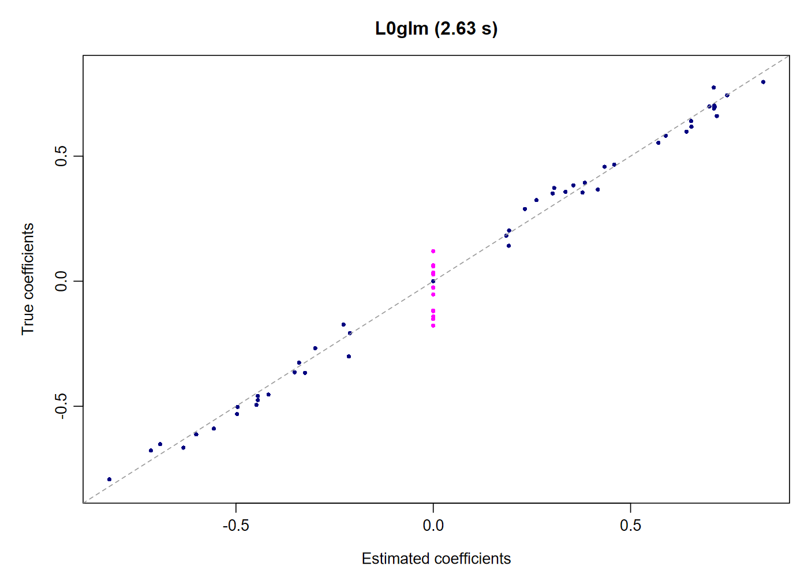
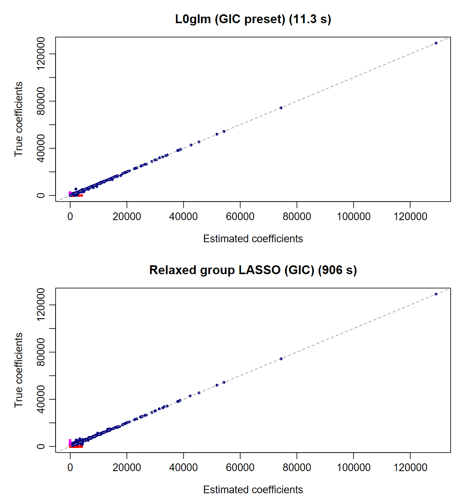

<!-- README.md is generated from README.Rmd. Run Rscript benchmarks/render_readme.R. -->

<picture>
  <source media="(prefers-color-scheme: dark)" srcset="L0glm/man/figures/logo-dark.svg">
  <source media="(prefers-color-scheme: light)" srcset="L0glm/man/figures/logo-light.svg">
  
</picture>

# L0glm: Scalable L₀ and Grouped L₀-Penalized Variable Selection for Generalized Linear Models

[Documentation and tutorials](https://tomwenseleers.github.io/L0glm/) · [Function reference](https://tomwenseleers.github.io/L0glm/reference/index.html)

`L0glm` fits **L0-penalized and grouped L0-penalized models** for best subset and
best subset of groups selection. It combines adaptive ridge with IRLS, fast
linear solvers and an optional relaxed refit to obtain sparse, low-bias estimates.
Strong signals receive progressively less shrinkage as the fit concentrates on
the active predictors, giving accurate coefficients with few false positives.
It is highly efficient, with fitting often being one or two orders of magnitude
faster than `glmnet` - the most widely used sparse regression framework - and
it is shown to return solutions with far fewer false positives, with similar or better
predictive power and sensitivity than other competing sparse regression methods, like
LASSO, adaptive LASSO, relaxed LASSO, MCP or SCAD. For most problems, performance
in terms of speed and quality of the solution obtained is also superior to that
of other packages aimed at best subset selection, such as abess and L0Learn.

The [Algorithm & theory guide](https://tomwenseleers.github.io/L0glm/articles/algorithm.html)
explains the mathematics, regularization presets and full fitting algorithms.

- **Families:** standard GLMs (gaussian, poisson, binomial, gamma, inverse gaussian,
  quasibinomial, quasipoisson) and their links, negative binomial with estimated
  shape, joint multinomial logistic regression, and right-censored Cox proportional
  hazards.
- **Data:** dense or sparse, tall or wide designs; single or multiple responses;
  [predictor-group and shared-row selection](https://tomwenseleers.github.io/L0glm/articles/predictor-groups.html);
  SIS/ISIS screening for ultrahigh dimensions.
- **Large files:** [file-backed screening and fitting](https://tomwenseleers.github.io/L0glm/articles/file-backed.html)
  for bigmemory, HDF5 single-cell assays and packed PLINK genotypes, with
  training-only imputation and original-dimension sparse coefficients.
- **Controls:** observation weights, offsets, unpenalized terms, starting values,
  normalization, original-scale coefficients and optional nonnegativity constraints.
- **Selection:** a fast GIC preset, information-criterion path selection, or
  cross-validation with minimum-deviance and one-standard-error models;
  [staged interaction selection](https://tomwenseleers.github.io/L0glm/articles/interactions.html)
  using `interactions=1L` for pairwise terms or `2L` for three-way terms.
- **Inference:** optional [selected-support standard errors and bootstrap
  selection stability](https://tomwenseleers.github.io/L0glm/articles/inference.html)
  through `summary(fit, inference="conditional")` or `"bootstrap"`.
- **Comparison:** `sparseGLM()` benchmarks L0glm, ABESS, L0Learn, LASSO, relaxed
  and adaptive LASSO, MCP and SCAD where their backends support the requested model.
  `method="biglasso"` adds native file-backed LASSO with IC or CV selection.

L0glm is the statistical fitting and variable-selection layer of a three-package toolkit. [logconNMF](https://tomwenseleers.github.io/logconNMF/) provides sparse log-concave matrix factorization, PSF estimation and blind deconvolution; [GCMSprime](https://tomwenseleers.github.io/GCMSprime/) provides the GC/MS workflow, chromatogram reports and spectral libraries. Generic simulated deconvolution remains available in L0glm.

## Installation

```r
install.packages("remotes")
remotes::install_github("tomwenseleers/L0glm", subdir="L0glm")
```

The source package is in `L0glm/`. Windows source installation requires
[Rtools](https://cran.r-project.org/bin/windows/Rtools/).
The special-family examples use `mgcv`; Cox also uses `survival`.

## One million predictor example

<!-- BEGIN million-intro -->
This Gaussian simulation has **one million predictors**, 1,000 observations and 60 nonzero effects. One default L0glm call takes **2.63 seconds** and recovers **46 true effects with no false positives**.
<!-- END million-intro -->

```r
library(L0glm)
set.seed(123)
n <- 1000L
p <- 1000000L
X <- matrix(rnorm(n*p), n, p)
active <- sample.int(p, 60L)
beta <- numeric(p)
beta[active] <- runif(60L, -.8, .8)
set.seed(1)
y <- as.numeric(X[, active] %*% beta[active]) + rnorm(n)

system.time(fit <- l0glmFit(X, y, family=gaussian()))
l0glmMetrics(fit, beta_true=beta)[
  c("gic", "TP", "FP", "FN", "TN", "F1_score", "MCC")]
```

<!-- BEGIN readme-million-comparison -->
| Method | Selection | Seconds | GIC | TP | FP | F1 | MCC |
| --- | --- | ---: | ---: | ---: | ---: | ---: | ---: |
| **L0glm + ISIS** | **GIC preset** | **2.63** | **4194** | **46** | **0** | **0.868** | **0.876** |
| LASSO | 5-fold CV | 205.98 | 14106 | 42 | 373 | 0.177 | 0.266 |
| Relaxed LASSO | 5-fold CV | 188.73 | 4475 | 31 | 1 | 0.674 | 0.707 |
<!-- END readme-million-comparison -->

<!-- BEGIN million-speed -->
L0glm is **78× faster than five-fold-CV LASSO** in this comparison, recovering **46 true effects with no false positives**.
<!-- END million-speed -->

L0glm uses its GIC preset with automatic ISIS screening and relaxed fitting.
Both LASSO methods use five-fold CV on paths of up to 40 lambda values.
The recovered coefficients are close to their true values.



See the [full comparison, including BIC-tuned LASSO](https://tomwenseleers.github.io/L0glm/articles/performance.html#one-million-predictor-example)
and the [SIS/ISIS tutorial](https://tomwenseleers.github.io/L0glm/articles/high-dimensional.html).
The dense design occupies about 8 GB. ISIS is enabled automatically when
`p_eligible > 10*n` and uses all physical cores by default.

The [file-backed tutorial](https://tomwenseleers.github.io/L0glm/articles/file-backed.html)
also constructs and analyses an **80 GB design with 10,000 observations and one
million predictors**, plus a packed logistic GWAS example with an interaction.

## Abess benchmark problems

<!-- BEGIN readme-abess-highlight -->
With **20,000 predictors**, L0glm matches ABESS's Gaussian GIC and support recovery in **0.37 s versus 1.80 s**. Its logistic fit takes **0.54 s**, recovering **14.7 of 20 true effects** with **no false positives** on average across three replications.
<!-- END readme-abess-highlight -->

The [full comparison](https://tomwenseleers.github.io/L0glm/articles/performance.html#abess-benchmark-problems)
also includes L0Learn, MCP, SCAD and adaptive LASSO variants on these harder
Gaussian and logistic problems.

## Single channel sparse deconvolution

A blurred Poisson spike train has **10,000 observations, 10,000 candidate peak
positions and 1,000 true peaks**.

<!-- BEGIN readme-single-highlight -->
L0glm achieves **F1 0.845 in 0.14 s** with its GIC preset, compared with **F1 0.534 in 2.77 s** for fully relaxed LASSO tuned by five-fold CV.
<!-- END readme-single-highlight -->

See the [single-sample comparison](https://tomwenseleers.github.io/L0glm/articles/performance.html#single-sample-deconvolution)
and [deconvolution tutorial](https://tomwenseleers.github.io/L0glm/articles/deconvolution.html)
for fitted signals, coefficient plots and code.

## Application: sparse multichannel deconvolution to separate overlapping GC/MS peaks

In **GC/MS analysis**, overlapping chromatographic peaks have distinct mass
spectra. Regressing the observed signals on shifted copies of a peak-shape
function lets L0glm select peak times jointly across mass channels and recover
their spectra. This Poisson simulation has **10,000 scans, 10,000 candidate peak
positions, 1,000 true peaks and all 226 informative mass channels**.

```r
multi <- simul(method=4L, n=10000L, p=10000L,
  n_nonzero=1000L, seed=2L)
fit_multi <- l0glmFit(multi$X, multi$y, family=poisson("identity"),
  lambda="gic", nonnegative=TRUE, ncores=4L)
```

<!-- BEGIN multi-speed -->
L0glm recovers **944 of 1,000 true peaks with 11 false positives** in **8.03 seconds**. In this benchmark it is **25.0× faster than GIC-tuned group LASSO** and **306× faster than relaxed group LASSO tuned by five-fold CV**.
<!-- END multi-speed -->

<!-- BEGIN readme-multi-comparison -->
| Method | Selection | Seconds | GIC | TP | FP | F1 | MCC |
| --- | --- | ---: | ---: | ---: | ---: | ---: | ---: |
| **L0glm** | **GIC preset** | **8.03** | **5606331** | **944** | **11** | **0.966** | **0.962** |
| Relaxed group LASSO | GIC path | 804.89 | 6138687 | 909 | 309 | 0.820 | 0.802 |
| Relaxed group LASSO | 5-fold CV | 2460.38 | 6198648 | 962 | 502 | 0.781 | 0.769 |
<!-- END readme-multi-comparison -->

The coefficient comparison shows how closely L0glm recovers individual
mass-spectral intensities.



<!-- BEGIN multi-spectral -->
Among correctly located peaks, the recovered mass spectra have a within-row F1 of **0.912** and MCC of **0.869**.
<!-- END multi-spectral -->

L0glm fits the Poisson model directly with four cores. The group-LASSO methods
use a weighted Gaussian approximation and select from ten lambda values;
deconvolution CV uses four parallel workers.
See the [full multichannel comparison](https://tomwenseleers.github.io/L0glm/articles/performance.html#multichannel-deconvolution)
and [heatmaps and fitted signals](https://tomwenseleers.github.io/L0glm/articles/deconvolution.html).

For compound-specific peak shapes, [logconNMF](https://tomwenseleers.github.io/logconNMF/)
fits log-concave profiles and spectra with a smooth background;
[GCMSprime](https://tomwenseleers.github.io/GCMSprime/) provides the complete
chromatogram-to-spectra workflow.

## Model selection and special families

An automatic preset such as `lambda="gic"` typically provides a near-optimal
sparse solution straight away. Tuning over a lambda grid or cross-validation
remains available to refine regularization or optimize out-of-sample prediction.

The default `local.search="auto"` refines completed models with at most 50
coefficient dimensions through predictor additions, removals and small exchanges,
after any SIS/ISIS screening. `TRUE` enables refinement for larger models and
`FALSE` returns the adaptive-ridge fit directly. See the
[controls and diagnostics](https://tomwenseleers.github.io/L0glm/reference/local_search.html)
and [benchmark examples](https://tomwenseleers.github.io/L0glm/articles/performance.html#abess-benchmark-problems).
The option is available in `l0glmFit()`, `l0nnPois()` and `l0glmTune()`, including
CV training fits.

```r
gic <- l0glmTune(multi$X, multi$y, family=poisson("identity"),
  tune="gic", nlambda=10L, nonnegative=TRUE, grouped=TRUE, relaxed=TRUE)
cv <- l0glmTune(multi$X, multi$y, family=poisson("identity"),
  tune="cv", nfolds=5L, nlambda=10L,
  nonnegative=TRUE, grouped=TRUE, relaxed=TRUE)
coef(cv$fit_1se)
predict(cv$fit_best, newdata=multi$X, type="response")
```

CV returns `lambda_best`, `lambda_1se`, `fit_best` and `fit_1se`, with both
models refitted on all observations. Plots show coefficient paths and mean
validation deviance ± one standard error.

The same interface supports negative binomial, joint multinomial and Cox
models. These small sparse simulations show a preset, GIC tuning and five-fold
CV for each family:

```r
fit_and_tune <- function(data) {
  args <- list(X=data$X, y=data$y, family=data$family,
    intercept=data$intercept, relaxed=TRUE, maxit=100L)
  list(preset=do.call(l0glmFit, c(args, list(lambda="gic"))),
    gic=do.call(l0glmTune, c(args, list(tune="gic", nlambda=10L))),
    cv=do.call(l0glmTune, c(args, list(tune="cv", nfolds=5L, nlambda=10L))))
}

nb <- fit_and_tune(simul("normal", n=300L, p=20L, n_nonzero=3L,
  family=mgcv::nb(), intercept=1, options=list(theta=2), seed=31L))
multinomial <- fit_and_tune(simul("normal", n=300L, p=20L, n_nonzero=3L,
  family=mgcv::multinom(K=2), intercept=c(.3, 0, -.3), seed=32L))
cox <- fit_and_tune(simul("normal", n=300L, p=20L, n_nonzero=3L,
  family=mgcv::cox.ph(), seed=33L))
fitted(multinomial$cv$fit_1se)  # category probabilities
```

Negative binomial models accept counts, multinomial models accept factors or
category-count matrices, and Cox models accept `survival::Surv(time, status)`.
Multinomial coefficients use zero-sum CLR contrasts; Cox predictions give
relative risks.

## Choose a starting point

| I would like to… | Start here |
|---|---|
| Fit a model and make predictions | [Get started](https://tomwenseleers.github.io/L0glm/articles/L0glm.html) |
| Choose a penalty by GIC or cross-validation | [Model selection](https://tomwenseleers.github.io/L0glm/articles/selection.html) |
| Use weights, constraints or held-out early stopping | [Fitting controls](https://tomwenseleers.github.io/L0glm/articles/controls.html) |
| Fit counts, classes or survival outcomes | [Negative binomial](https://tomwenseleers.github.io/L0glm/articles/negative-binomial.html) · [Multinomial](https://tomwenseleers.github.io/L0glm/articles/multinomial.html) · [Cox](https://tomwenseleers.github.io/L0glm/articles/cox.html) |
| Search a very large predictor set | [SIS / ISIS](https://tomwenseleers.github.io/L0glm/articles/high-dimensional.html) |
| Understand the mathematics | [Algorithm & theory](https://tomwenseleers.github.io/L0glm/articles/algorithm.html) |
| Compare speed and support recovery | [Benchmarks](https://tomwenseleers.github.io/L0glm/articles/performance.html) |

## Foundations

The method builds on adaptive ridge and broken adaptive ridge, with an IRLS
implementation for generalized linear models. The [algorithm article](https://tomwenseleers.github.io/L0glm/articles/algorithm.html)
develops the quadratic updates and their connection to sparse penalties, drawing
on [Frommlet & Nuel (2016)](https://doi.org/10.1371/journal.pone.0148620),
[Li et al. (2021)](https://doi.org/10.1016/j.jspi.2020.12.001) and
[Abergel, Bouaziz & Nuel (2024)](https://doi.org/10.1007/s11222-024-10440-6).
It also explains screening, grouped selection and likelihood-based scoring.
The adaptive updates also have a [hierarchical Bayesian and automatic relevance
determination (ARD) interpretation](https://tomwenseleers.github.io/L0glm/articles/algorithm.html#a-hierarchical-bayesian-and-ard-view):
each ridge step estimates a Gaussian-prior MAP, then the prior scales adapt to
the fitted effects. Zero-centered skeptical priors tighten around small effects
and relax around strong ones.

## Reproduce and extend

The [performance page](https://tomwenseleers.github.io/L0glm/articles/performance.html)
gives the complete comparisons, simulation settings and timing conventions.
These benchmarks use an **HP ZBook Fury G8**, **Intel Core i9-11950H at 2.60 GHz**,
**8 physical / 16 logical cores**, Windows, R 4.5.0 and OpenBLAS.

- [Benchmark scripts and measurements](benchmarks/plots/website/README.md).
- [Fit examples](L0glm/examples/l0glmFit.R) and [tuning examples](L0glm/examples/l0glmTune.R).
- Use [`sparseGLM()`](https://tomwenseleers.github.io/L0glm/reference/sparseGLM.html)
  to compare methods on your own data.

Run `Rscript benchmarks/render_readme.R` to regenerate these highlights from
the shared benchmark measurements and figures.

## Citation

An article describing the methods implemented in L0glm is in preparation.
If you use the package before the article is formally published, we would
appreciate a citation to the package:

Wenseleers T, Lanzas L, Vanderaa C (2026).
*L0glm: Scalable L₀ and Grouped L₀-Penalized Variable Selection for Generalized Linear Models*.
R package version 0.2.0.9000,
<https://tomwenseleers.github.io/L0glm/>.

The [Authors and Citation page](https://tomwenseleers.github.io/L0glm/authors.html#citation) also provides the
citation in BibTeX format.

## Acknowledgements

OpenAI Codex, using GPT-6 Astra and GPT-6.1 Sol, was used to optimize and
refactor code and help draft the documentation. The key ideas and methodological
decisions are the authors' own, and the authors take full responsibility for the
work presented here.
