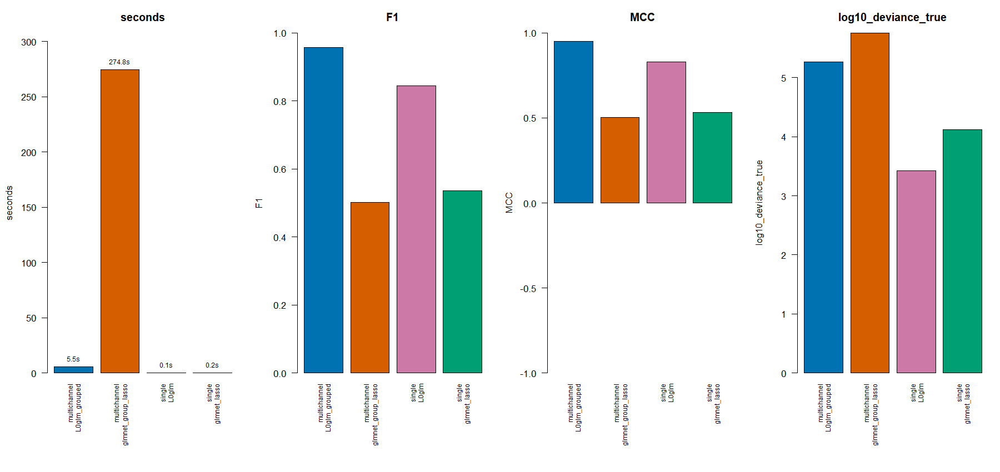
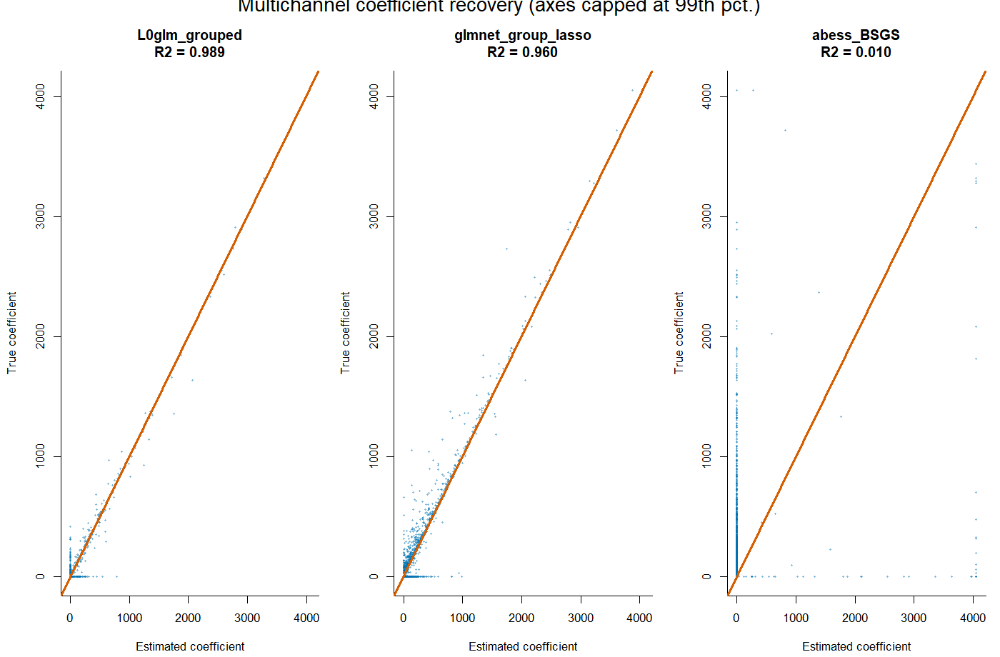
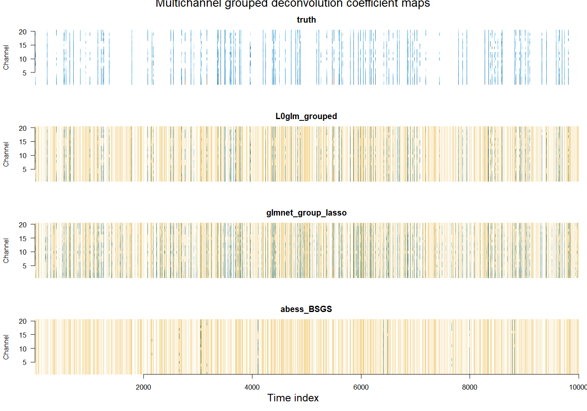

---

editor_options: 
  markdown: 
    wrap: 72
---

# L0glm: Fast and Scalable Best Subset and Best Subset of Groups Selection for Generalized Linear Models (GLMs)

`L0glm` is an R package for fitting L0-Norm or Group-L0 Norm penalized generalized linear models (GLMs). It is aimed at best subset selection and best subset of group selection in low- and high-dimensional settings, including sparse signal deconvolution problems such as overlapping peak recovery in GC/MS chromatography.

The package approximates L0-penalized GLM objectives with an iterative adaptive ridge procedure. In each IRLS step, the usual weighted least-squares update is replaced by an adaptive ridge-regularized solve, optionally with nonnegativity or box constraints. This gives a practical route to sparse, low-bias coefficient estimates in cases where LASSO-type L1 penalties tend to select too many variables and shrink peak areas or effect sizes.

The package supports:

- single-output L0 best subset selection;
- multichannel or multitask independent elementwise L0 and grouped row-L0 (L2,0) best subset of groups selection;
- Gaussian, Poisson, binomial, Gamma and inverse Gaussian GLM families and links;
- sparse and dense design matrices, including high-dimensional `p >= n` problems with millions of variables;
- nonnegative or box-constrained coefficients;
- unpenalized terms, offsets, observation weights, starting values and prior means;
- automatically setting the level of regularisation to approximate information-criteria such as `"aic"`, `"bic"`, `"gic"`, `"ebic"` or `"mbic"`, without requiring computationally expensive cross-validation;
- several fast least-squares backends, including Eigen Cholesky, QR, CG and LSCG solvers, plus `glmnet::bigGlm` and `osqp`-based constrained solvers.

The source package is in the `L0glm/` subdirectory of this repository.

## Installation

Install from GitHub with:

``` r
install.packages("remotes")
remotes::install_github("tomwenseleers/L0glm", subdir = "L0glm")
```

From a local checkout of this repository:

``` r
remotes::install_local("L0glm")
```

On Windows, source installation may require Rtools because the package contains C++ code.

## What does `L0glm.fit()` optimize?

For one response, `L0glm.fit()` approximates

``` text
-2 * logLik + lambda * ||beta||_0
```

For multichannel responses, it can either fit independent elementwise L0 models or use a grouped row-L0 penalty, equivalent to an L2,0 penalty, to select the same active predictors across the different outcomes (tasks/channels). For a `p x m` coefficient matrix `B`, the grouped penalty counts rows with at least one nonzero channel coefficient:

``` text
-2 * logLik(B) + lambda * sum_j sum_k I(B[j,k] != 0)        # independent channel fits
-2 * logLik(B) + lambda * sum_j I(||B[j, ]||_2 > 0)         # grouped feature selection
```

Any positive within-row norm gives the same row support, so the grouped penalty can also be described as group-L0 or row-L0 regularisation.

The penalty parameter can be supplied directly or can be pre-set to approximate a given information criterion (without requiring expensive cross-validation):

``` r
fit <- L0glm.fit(
  X,
  y,
  family = poisson(identity),
  lambda = "gic",
  nonnegative = TRUE
)
```

For identity-link Poisson models, `nonnegative = TRUE` is often important because it keeps fitted means nonnegative, which is necessary when coefficients represent concentrations or peak intensities.

## Basic sparse GLM example

``` r
library(L0glm)
library(Matrix)

set.seed(1)
n <- 200
p <- 1000
active <- sample(p, 20)

X <- rsparsematrix(n, p, density = 0.05)
X@x <- abs(X@x)
beta <- numeric(p)
beta[active] <- runif(length(active), min = 1, max = 3)
y <- rpois(n, lambda = pmax(as.vector(X %*% beta), 0.1))

fit <- L0glm.fit(
  X,
  y,
  family = poisson(identity),
  lambda = "gic",
  nonnegative = TRUE,
  intercept = FALSE
)

which(as.vector(fit$coefficients) != 0)
```

## Deconvolution of overlapping peaks

The same API can be used for peak deconvolution. If `g` is a peak shape or point-spread function, `convmatrix(g, n)` builds a sparse Toeplitz design whose columns are time-shifted copies of that peak shape. Deconvolution then becomes a sparse GLM problem: estimate the latent nonnegative spike train `a` from `y ~= X(g) %*% a`.

This is useful for one-dimensional chromatograms and for multichannel GC/MS data, where several mass channels can be deconvolved jointly. The package also contains higher-level helpers:

- `L0glm_sparse_deco()` for fixed-PSF sparse deconvolution;
- `L0glm_blind_deco()` for alternating blind deconvolution, estimating both the sparse peak train and the point-spread function;
- `simulate_GCMS()` for synthetic GC/MS chromatograms with ground-truth peaks, spectra and background.

### README benchmark

The README benchmark is generated by [`benchmarks/readme_benchmarks_L0glm_deconvolution.R`](benchmarks/readme_benchmarks_L0glm_deconvolution.R). It reproduces the benchmark style of `benchmarks/2_benchmarks_L0glm_single_and_multichannel_vs_other_methods.R` with `n = p = 10000` and `npeaks = 1000`.

``` sh
Rscript benchmarks/readme_benchmarks_L0glm_deconvolution.R
```

Outputs are written to [`benchmarks/readme_benchmarks/`](benchmarks/readme_benchmarks/), including a CSV table, an RDS object with the fitted coefficients, and PNG figures. The default multichannel example uses the 20 strongest simulated mass channels; set `L0GLM_README_CHANNELS` to rerun with a different number of channels.

For L0glm, the reported timing is the direct call to `L0glm.fit(lambda = "gic")`, because the GIC penalty is available as a preset and no regularisation path or cross-validation is needed. For `glmnet` and `abess`, the reported time includes fitting the regularisation/support path and choosing the model by a GIC-style criterion. `glmnet` and `abess` are Gaussian approximations here: single-channel Poisson data are fit with inverse-mean weights, and multichannel data use `mgaussian` group LASSO or best-subset-of-groups selection.



#### Single-channel Poisson deconvolution

The single-channel example uses the package's `simul(method = 2)` spike-train deconvolution setup with Poisson noise.

| Method | Seconds | Selected | TP | FP | FN | F1 | R2 coeff. | No-noise deviance | GIC |
|--------|-------:|-------:|-------:|-------:|-------:|-------:|-------:|-------:|-------:|
| L0glm | 0.41 | 999 | 845 | 154 | 155 | 0.845 | 0.920 | 2.67e3 | 1.03e5 |
| glmnet LASSO | 0.19 | 2559 | 954 | 1605 | 46 | 0.536 | 0.836 | 1.31e4 | 1.44e5 |
| abess | 35.56 | 74 | 34 | 40 | 966 | 0.063 | 0.000 | 3.29e10 | 3.29e10 |

`glmnet` recovers more true peaks in this run, but at the cost of many more false positives. L0glm gives the best GIC, much lower no-noise deviance than the alternatives, and a substantially cleaner support.


#### Multichannel grouped deconvolution

For GC/MS-like data, each chromatographic peak has a spectrum across mass channels. Passing an `n x m` response matrix to `L0glm.fit()` with `grouped = TRUE` performs grouped feature selection: a peak is selected as a shared event across channels while the peak areas can differ by channel.

| Method | Seconds | Selected | TP | FP | FN | F1 | R2 coeff. | No-noise deviance | GIC |
|--------|-------:|-------:|-------:|-------:|-------:|-------:|-------:|-------:|-------:|
| grouped L0glm | 8.83 | 979 | 918 | 61 | 82 | 0.928 | 0.992 | 3.37e4 | 1.43e6 |
| glmnet group LASSO | 6.75 | 3424 | 970 | 2454 | 30 | 0.439 | 0.970 | 1.16e5 | 2.22e6 |
| abess BSGS | 40.82 | 91 | 29 | 62 | 971 | 0.053 | 0.000 | 5.08e9 | 5.08e9 |

The multichannel group LASSO again recovers many true peaks but selects a large number of extra peaks. The grouped L0 fit is designed to be more selective when support recovery is the priority.





## Blind deconvolution for GC/MS chromatography

When the peak shape is not known, `L0glm_blind_deco()` alternates between:

1.  estimating the sparse nonnegative peak train with `L0glm_sparse_deco()`;
2.  estimating the point-spread function with `L0glm_deco_estkernel()`.

This implements efficient blind deconvolution of overlapping peaks and can be used on one channel or several channels jointly:

``` r
fit <- L0glm_blind_deco(
  y,
  family = poisson(identity),
  L = 51,
  baseline = "intercept",
  kernel_est = convkernel("gaussian", 51, list(sigma = 6)),
  kernel_smoothfun = function(g) log_conc_smooth(g, nknots = 10),
  IC = "gic",
  grouped = TRUE
)

spikes_hat <- fit$a_hat
kernel_hat <- fit$g_hat
```

The deconvolution functions are motivated by GC/MS chromatogram peak deconvolution, but the same model applies to other one-dimensional blurred signals with sparse nonnegative activations, such as spectroscopy, calcium imaging or delay-distribution deconvolution.

## Main functions

- `L0glm.fit()` fits sparse single- or multichannel GLMs.
- `L0glm.tune()` tunes regularization paths.
- `convkernel()` generates normalized 1-D peak/point-spread functions.
- `convmatrix()` builds sparse convolution design matrices.
- `L0glm_sparse_deco()` deconvolves a signal with a fixed PSF.
- `L0glm_blind_deco()` estimates both sparse peaks and the PSF.
- `simulate_spike_train()` simulates single- or multichannel blurred spike trains.
- `simulate_GCMS()` simulates synthetic GC/MS chromatograms with ground truth.
- `benchmark_sparse_glm()` and `benchmark_sparse_group_glm()` provide benchmark wrappers for simulated sparse GLM examples.

## References

The method builds on adaptive-ridge approximations to L0 regularization and sparse deconvolution work, including:

- de Rooi and Eilers (2011), *Deconvolution of pulse trains with the L0 penalty*.
- Frommlet and Nuel (2016), *An adaptive ridge procedure for L0 regularization*.
- Liu, Sun and McGovern (2017), *Sparse generalized linear model with L0 approximation for feature selection and prediction with big omics data*.
- Dai et al. (2018, 2020), broken adaptive ridge regression.
- Li et al. (2021), scalable surrogate L0 sparse regression for GLMs.

See the package help pages for the full reference list:

``` r
?L0glm.fit
?L0glm_sparse_deco
?L0glm_blind_deco
```
