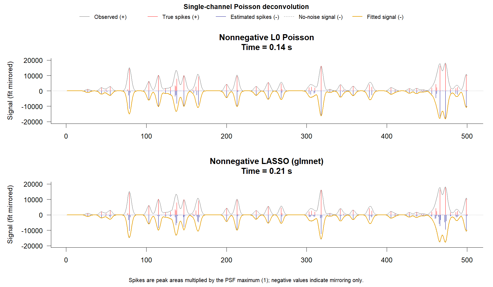
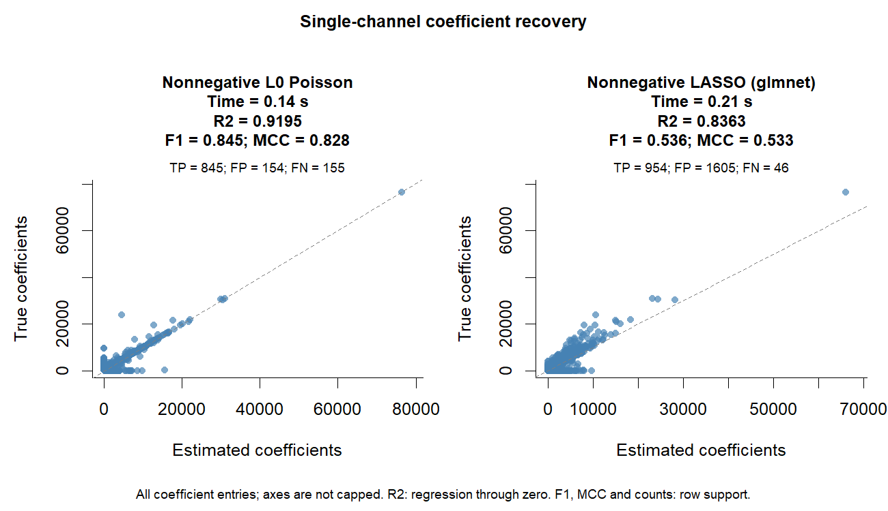
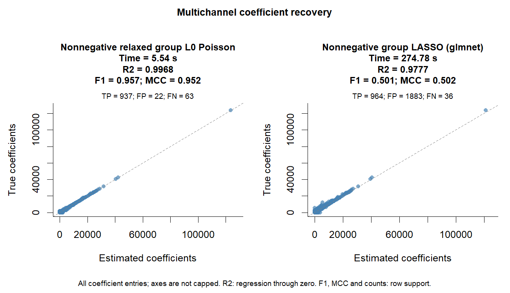
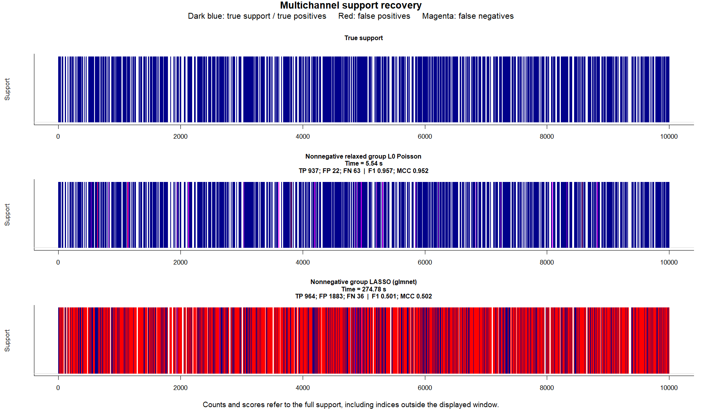
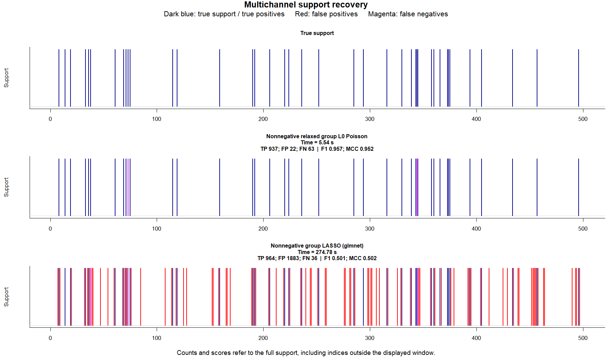

------------------------------------------------------------------------

# L0glm: Fast and Scalable Best Subset and Best Subset of Groups Selection for Generalized Linear Models (GLMs)

`L0glm` is an R package for fitting L0-Norm or Group-L0 Norm penalized generalized linear models (GLMs). It is aimed at **best subset selectio**n and **best subset of group selectio**n in low- or high-dimensional settings, and is shown to have major applications for **efficient sparse signal deconvolution**, e.g. to reliably separate overlapping peaks in GC/MS chromatography. For typical problem sizes (e.g. `n=p=10000` and 550 outcome m/z mass channels), the package is shown to be ca. two orders of magnitude faster than a group LASSO `glmnet` fit, and results in drastically reduced false positive rates, whilst returning a solution that is extremely close to the underlying ground truth. The poor performance of `glmnet` when applied to deconvolution problems is linked to the fact that the Toeplitz design matrix that arises in such problems (consisting of shifted copies of the point spread function) causes the **irrepresentable condition** to be violated, and this is needed for asymptotically correct support recovery with LASSO or group LASSO models. The methods used here do not suffer from this limiting requirement, and can effectively return a solution close to the ground truth, even for small datasets with more variables than cases (`p >= n`).

The package approximates L0-penalized GLM objectives with an **iterative adaptive ridge procedure**. In each IRLS step, the usual weighted least-squares update is replaced by an adaptive ridge-regularized solve, optionally with **nonnegativity constraints.** This gives a practical route to sparse, low-bias coefficient estimates that closely match the underlying true coefficients, including in cases where LASSO or group-LASSO type penalties would select too many or the wrong variables (e.g. due to violations of the irrepresentable condition) and return coefficients with a heavy downward bias.

The package supports:

- single-output L0 best subset selection;
- multichannel or multitask independent elementwise L0 and grouped row-L0 (L2,0) best subset of groups selection;
- Gaussian, Poisson, binomial, Gamma and inverse Gaussian GLM families with selectable link functions;
- sparse or dense design matrices and support for high-dimensional `p >= n` problems with millions of variables;
- optional nonnegativity constraints on coefficients;
- unpenalized terms, offsets, observation weights, starting values and optional nonzero prior means;
- automatically setting the level of regularisation to approximate information-criteria such as `"aic"`, `"bic"`, `"gic"`, `"ebic"` or `"mbic"`, without requiring computationally expensive cross-validation;
- several fast least-squares backends, including Eigen Cholesky, QR, CG and LSCG solvers, plus `glmnet::bigGlm` and `osqp`-based constrained solvers for sparse or dense systems.

The source package is in the `L0glm/` subdirectory of this repository.

Fitting defaults are `maxit = 25, tol = 1e-10`. Increase `maxit` explicitly when
more iterations are needed, and inspect the returned `convergence` diagnostics.
For signed models, `normalize = "auto"` uses centered RMS scaling with L2 norm
`sqrt(n)` when there is a free intercept. Fully nonnegative models retain
`normalize = "none"`, including peak-one PSF deconvolution designs.
Numeric scalar `start = 1` means ones in normalized working coefficient
coordinates. Other scalars and all explicit vectors/matrices use original input
coefficient units. With `normalize = "none"`, these unit-start conventions
coincide. See the [QSAR benchmark](benchmarks/2_benchmark_vs_abess_relaxed_LASSO_toxicityQSAR/README.md)
for comparisons of both L2 conventions, starts and iteration budgets.

The [GLM performance benchmark](benchmarks/3_benchmark_fastglm_sparse_and_documented/README.md)
compares fastglmPure, L0glm and abess across sparse-truth simulations and the
documented fastglm examples, including dense solutions, timings and convergence diagnostics.

## Installation

Install from GitHub with:

``` r
install.packages("remotes")
remotes::install_github("tomwenseleers/L0glm", subdir = "L0glm")
```

On Windows, source installation may require [Rtools](https://cran.r-project.org/bin/windows/Rtools/) because the package contains C++ code.

## What does `L0glm.fit()` optimize?

For single response GLM models, `L0glm.fit()` approximately optimises an **L0-penalized GLM objective**

``` text
-2 * logLik + lambda * ||beta||_0
```

If `lambda` is preset to ``` log(p) *``log(log(n)) ``` this objective optimises the Generalised Information Criterion (`gic`), which aims to achieve consistent variable selection for both low and high dimensional problems (see below), thereby allowing us to approximate **best subset selection**.

For multichannel responses, `L0glm.fit()` can either fit independent elementwise L0 models or can approximate a grouped row-L0 penalty, equivalent to an L2,0 penalty, to select the same active predictors across the different outcomes (tasks/channels). For a `p x m` coefficient matrix `B`, this grouped penalty counts rows with at least one nonzero channel coefficient :

``` text
-2 * logLik(B) + lambda * sum_j sum_k I(B[j,k] != 0)        # independent channel fits
-2 * logLik(B) + lambda * sum_j I(||B[j, ]||_2 > 0)         # grouped feature selection
```

Such group penalized models are known as group-L0 or row-L0 regularised fits, and with appropriately chosen lambda (e.g. with `lambda = "gic"` which sets ``` lambda =``log(p) *``log(log(n)) ```, these models can achieve "**best subset of group selection**" (BSGS).

Optional **nonnegativity constraints** on the coefficients are also supported (applied to all terms except the intercept for binomial or quasibinomial models) and are needed e.g. to stably fit identity link Poisson models. The basic syntax to fix such models, with (sparse or dense) design matrix `X` and outcome `y` either being a single-response vector or a multi-response matrix, and with the L0-norm per-coefficient penalty set to approximate the Generalised Information Criterion `gic`, is :

``` r
fit <- L0glm.fit(
  X,
  y,
  family = poisson(identity),
  lambda = "gic",
  nonnegative = TRUE,
  intercept = TRUE
)
```

If design matrix X is chosen to be a Toeplitz matrix with time-shifted copies of the point spread function, this model can be used to reliably estimate additive mixtures of peaks in GC/MS chromatography with electron multiplier counts across many m/z mass channels. `L0nnpois()` is a specialized Rcpp OpenMP optimized nonnegative identity-link Poisson L0glm fitter, which is highly efficient for such multichannel data :

``` r
fit <- L0nnpois(X, y, lambda = "gic", intercept = TRUE)
```

`L0glm.fit()` uses this compiled backend automatically when `openmp = TRUE` (the default), `nonnegative = TRUE`, `family = poisson(identity)`, `solver = "eigen"`, and `method = 1L`. Set `openmp = FALSE` to select the general R implementation. `parallelize = FALSE` runs the compiled backend serially; for multichannel parallel fits, `ncores` controls its OpenMP threads. Other families, links, solver methods, and incompatible solver controls retain the general implementation. `L0nnpois()` now defaults to `lambda = "gic"`; `L0glm.fit()` retains its numeric default, so specify `lambda = "gic"` there.

The current Eigen method codes are `1L` = Cholesky LLT, `2L` = Cholesky LDLT, `3L` = PCG with incomplete Cholesky, `4L` = LSCG with diagonal preconditioning, `5L` = column-pivoted QR, and `6L` = dense BDCSVD or sparse Jacobi SVD.

## Pre-setting regularisation to approximate information criteria

A great advantage of `L0glm.fit()` (and `L0nnpois()`) is that the level of regularisation can be pre-set to approximate particular information criteria, without requiring expensive cross validation. This means that for realistic problem sizes arising in GC/MS chromatography peak deconvolution (`n=p=10000` and ca. 550 outcome m/z mass channels) it can be ca. two orders of magnitude faster than optimally tuned group LASSO models fit using `glmnet` whilst also returning a much higher quality of solution with a drastically reduced number of false positives and much less bias.

For a single response, the objective that is minimised is `-2 * logLik + lambda * k`, where `k` counts selected coefficients. Given the similarity of this objective function to traditional information criteria of model fit, we can see that we can preset `lambda` to apply the following per-coefficient penalties on the minus 2 log-likelihood scale and approximately optimise given information criteria (`n` is the number of observations and `p` the number of design columns, including an intercept added by the fitter) :

| Preset | `lambda` | Intended use |
|----|----|----|
| `aic` | `2` | Prediction-oriented model selection approximating leave-one-out-cross-validations; typically does not lead to consistent variable selection. |
| `bic` | `log(n)` | Consistent variable selection in low-dimensional settings. |
| `gic` | `log(p) * log(log(n))` | Consistent variable selection in low or high-dimensional settings, under the conditions listed by Fan & Tang (2013). |
| `ebic` | `log(n) + 2 * gamma_ebic * log(p)` with `gamma_ebic = max(0, 1 - log(n)/(2 * log(p)))` | Consistent variable selection in high or ultrahigh-dimensional settings. Reduced to BIC when `p <= sqrt(n)`. |
| `mbic` | `log(n * p^2 / 16)` | Consistent variable selection in high or ultrahigh-dimensional settings. |

The implemented linear EBIC penalty approximates Chen & Chen's combinatorial model-space term `2 * gamma_ebic * log(choose(p, k))` by `2 * gamma_ebic * k * log(p)`. Note that the ABESS paper (Zhu et al., 2020) referred to the GIC penalty as SIC, the special information criterion, and introduced it as a special case of HBIC (Wang, Kim & Li, 2013). The HBIC family uses `Cn * log(p)` with a slowly diverging `Cn`; choosing `Cn = log(log(n))` gives the GIC penalty.

These presets specify the statistical target. Adaptive ridge approximates it, and therefore does not guarantee returning the global best-subset solution, even though in practice it frequently does. The internal `lambda * dispersion / 4` scaling follows the orthogonal Gaussian threshold calibration derived by Frommlet & Nuel (2016); its use for general GLMs is also approximate but works well in practise. No criterion is uniformly best across different signal strengths and sample sizes. As in the `abess` package, for multichannel fits, reported IC scores simply count nonzero coefficient entries across all outcomes.

`L0glm.fit()` and `L0nnpois()` use `thresh = 1e-5` by default and unsmoothed adaptive ridge weights `1 / abs(beta)^gamma`. During each selection update, coefficients satisfying `abs(beta) < max(abs(beta)) * thresh` or `abs(beta) < 1e-20` are set to zero and remain excluded within that IRLS run. The maximum is calculated per response channel. Setting `thresh = 0` disables only the relative cutoff. The final relaxed refit applies neither cutoff. Grouped passes and the relaxed refit can restart channel coefficients on retained rows.

For families with unknown dispersion, `L0glm.fit(dispersion = NULL)` initializes it from a weak ridge pilot, starts permissively, and updates it within the existing IRLS loop. Updates use current Pearson residuals and require adequate residual degrees of freedom; each change is bounded to a factor of two. After three changes below 1% with unchanged support, dispersion is kept fixed for the remaining coefficient iterations. A positive value fixes dispersion throughout the fit; a negative value supplies an initial value that is subsequently estimated:

```r
# Gaussian dispersion is variance, not standard deviation.
fit <- L0glm.fit(X, y, family = gaussian(), lambda = "gic",
                dispersion = NULL, maxit = 100)  # automatic start and estimation
# Use dispersion = 25 for a fixed variance of 25, or dispersion = -25
# to start at 25 and estimate it. A vector supplies one value per channel.
```

The automatic pilot uses one factorization and preserves the random-number state; subsequent scale updates need only linear-time arithmetic in the number of observations. Positive known values remain fixed during grouped and relaxed fits. For estimated channels, a relaxed refit reports its final Pearson residual scale. These are moment estimates with approximate model degrees of freedom, not exact maximum-likelihood dispersion estimates for every family or a guarantee of optimal subset selection. Poisson, binomial and negative binomial with known `theta` retain dispersion 1. See `?L0glm.fit` for details.

`L0glm.tune()` selects lambda with `tune = "gic"` (the default), another supported information criterion, or `tune = "cv"` for cross-validation. The former `IC` argument is now named `tune`. Cross-validation uses `nfolds = 5` by default and shows mean held-out deviance with plus/minus one standard error in the right-hand panel. Both panels mark `lambda_best` with a dashed red line, `lambda_1se` with a blue dot-dash line, and the full-data GIC preset with a dotted red line. The one-SE choice is the largest evaluated lambda whose finite mean deviance is within one SE of the minimum, using the SE at that minimum. `fit_best` and `fit_1se` return the full-data models at those two lambdas, retained from the path without extra fits. `fit_1se` is `NULL` for IC tuning.

Both tuning panels use `log10(lambda)` with a reversed axis, so larger penalties appear on the left and weaker regularization on the right. Coefficient paths have different colors and a mathematical beta-hat axis label; multichannel paths show coefficient row means. The top axes show support sizes at 16 equally spaced positions on the log scale, using the nearest evaluated lambda. Multichannel support counts rows with any nonzero coefficient, even when channel means cancel. Counts include nonzero intercepts and always-included terms, and the annotations require no extra fits.

The full lambda range starts at `lambda_min = 2` (the AIC preset) and ends at the verified numerical `lambda_max`. Smaller positive lower bounds can be supplied explicitly. This is a practical default for avoiding very weakly penalized fits, particularly with Eigen's nonnegativity clipping; AIC does not establish a universal lower bound for CV-optimal penalties or guarantee solver stability. `prop_range < 1` moves both endpoints toward the reference on the log scale. The reference is at least `lambda_min`, while `lambda_preset` retains its original value. CV fold penalties still use their training-weight fraction of the full-data lambda.

```r
set.seed(1)
cv_fit <- L0glm.tune(X, y, family = poisson(identity),
                    tune = "cv", nfolds = 5, nlambda = 10,
                    prop_range = 1, lambda_min = 2, nonnegative = TRUE,
                    relaxed = FALSE, plot = TRUE)
cv_fit$lambda_best
cv_fit$lambda_1se     # Largest lambda within one SE of the CV minimum
cv_fit$lambda_preset  # GIC reference
fit_best <- cv_fit$fit_best
fit_1se <- cv_fit$fit_1se
cv_fit$metrics[, c("lambda", "cv_deviance", "cv_se")]
```

Each fold holds out whole observation rows across all channels. Coefficients, grouped selection and estimated dispersion are fitted from training rows. Observation weights and offsets are included in validation, and all observations with positive weight are retained. Fold deviances are normalized by validation prior weight; their weighted mean and standard error are returned in `cv_fit$cv`, along with the individual fold scores and assignments. Since the fitter uses total log likelihood, each fold's training penalty is scaled by its fraction of total prior weight; the reported lambda remains on the full-data scale. `fit_best` is the corresponding model fitted on all data. Supply the returned `foldid` in another call to reuse the same split, or provide custom folds when random row splits do not match the intended prediction setting.

`L0glm.tune()` initializes each lambda fit independently. Its GIC preset is an approximate adaptive-ridge calibration; a finer grid can select a different value, especially for correlated predictors or unrelaxed fits. The automatic dispersion start uses a fixed GIC reference rather than the fitted lambda, so increasing lambda cannot cancel itself through the starting dispersion. The returned `lambda_max` is verified by fitting the upper endpoint and refined between nonzero and zero fits to within 5%; `endpoint_zero` records whether all penalized coefficients are zero. This is a numerical path endpoint, not a certificate for the exact L0 objective. For scoring, `mu_floor = 1e-8` keeps Poisson comparisons finite when some fitted means are zero, while retaining all observations. This floor affects scoring only. Setting `mu_floor = 0` requests exact likelihood scoring, which can be infinite for a zero mean and positive count. The returned `coefficients` and `fit_best` allow inspection of the fitted models.

See `help("information_criteria", package = "L0glm")` for further details, scoring conventions and executable examples. Original references:

- Akaike, H. (1974). *A new look at the statistical model identification.* IEEE Transactions on Automatic Control 19, 716–723. [DOI](https://doi.org/10.1109/TAC.1974.1100705).
- Schwarz, G. (1978). *Estimating the dimension of a model.* Annals of Statistics 6, 461–464. [DOI](https://doi.org/10.1214/aos/1176344136).
- Fan, Y. & Tang, C. Y. (2013). *Tuning parameter selection in high dimensional penalized likelihood.* JRSS B 75, 531–552. [DOI](https://doi.org/10.1111/rssb.12001).
- Wang, L., Kim, Y. & Li, R. (2013). *Calibrating nonconvex penalized regression in ultra-high dimension.* Annals of Statistics 41, 2505–2536. [DOI](https://doi.org/10.1214/13-AOS1159).
- Zhu, J., Wen, C., Zhu, J., Zhang, H. & Wang, X. (2020). *A polynomial algorithm for best-subset selection problem.* PNAS 117, 33117–33123. [DOI](https://doi.org/10.1073/pnas.2014241117).
- Chen, J. & Chen, Z. (2008). *Extended Bayesian information criteria for model selection with large model spaces.* Biometrika 95, 759–771. [DOI](https://doi.org/10.1093/biomet/asn034).
- Bogdan, M., Ghosh, J. K. & Zak-Szatkowska, M. (2008). *Selecting explanatory variables with the modified version of the Bayesian information criterion.* Quality and Reliability Engineering International 24, 627–641. [DOI](https://doi.org/10.1002/qre.936).
- Frommlet, F. & Nuel, G. (2016). *An adaptive ridge procedure for L0 regularization.* PLOS ONE 11, e0148620. [DOI](https://doi.org/10.1371/journal.pone.0148620).

## Basic sparse GLM example

``` r
library(L0glm)
library(Matrix)

set.seed(1)
n <- 200
p <- 1000
active <- sample(p, 20)

X <- rsparsematrix(n, p, density = 0.05)
X@x <- abs(X@x)
beta <- numeric(p)
beta[active] <- runif(length(active), min = 1, max = 3)
y <- rpois(n, lambda = pmax(as.vector(X %*% beta), 0.1))

fit <- L0glm.fit(
  X,
  y,
  family = poisson(identity),
  lambda = "gic",
  nonnegative = TRUE,
  intercept = FALSE
)

which(as.vector(fit$coefficients) != 0)
```

## Application to sparse deconvolution problems to separate overlapping peaks

The same API can be used for peak deconvolution. If `g` is a peak shape or point-spread function, `convmatrix(g, n)` builds a sparse Toeplitz design whose columns are time-shifted copies of that peak shape. Deconvolution then becomes a sparse GLM problem: estimate the latent nonnegative spike train `a` from `y ~= X(g) %*% a`.

This is useful for one-dimensional chromatograms and for multichannel GC/MS data, where several mass channels can be deconvolved jointly. The package also contains higher-level helpers:

- `L0glm_sparse_deco()` for fixed-PSF sparse deconvolution;
- `L0glm_blind_deco()` for alternating blind deconvolution, estimating both the sparse peak train and the point-spread function;
- `simulate_GCMS()` for synthetic GC/MS chromatograms with ground-truth peaks, spectra and background.

### README benchmark

The README benchmark is generated by [`benchmarks/readme_benchmarks_L0glm_deconvolution.R`](benchmarks/readme_benchmarks_L0glm_deconvolution.R). It reproduces the benchmark style of `benchmarks/2_benchmarks_L0glm_single_and_multichannel_vs_other_methods.R` with `n = p = 10000` and `npeaks = 1000`.

From the repository root:

``` sh
Rscript benchmarks/readme_benchmarks_L0glm_deconvolution.R
```

In RStudio, with the working directory set to the package directory (`L0glm/`):

``` r
source("../benchmarks/readme_benchmarks_L0glm_deconvolution.R")
```

You can also execute the script's sections directly. Paths are resolved from the working directory.

Local outputs are written to `codex_sandbox/readme_benchmarks/`, which is ignored by Git, including a CSV table, an RDS object with the fitted coefficients, and PNG figures. Only the six figures displayed below are kept in [`benchmarks/plots/readme/`](benchmarks/plots/readme/); copy updated versions there when refreshing the published README. The default multichannel example uses the 200 strongest simulated mass channels.

For L0glm, the reported timing is the direct call to `L0glm.fit(lambda = "gic", openmp = TRUE)`, dispatching to the OpenMP optimised version `L0nnpois`. For glmnet, time includes fitting the regularisation path and selecting its smallest observed-data Poisson GIC. Timings also appear in each method's plot heading.

The Gaussian glmnet fits are approximations to the Poisson model. Single-channel fits use weights `1 / (y + 0.1)`; multichannel fits use shared row weights `1 / (rowMeans(Y) + 0.1)` (glmnet's `mgaussian` family accepts a length-`n` vector of weights, not an `n x m` precision matrix). L0glm instead uses the Poisson family with channel-specific IRLS weights.

Both F1 and MCC (Matthews correlation coefficient, or Pearson's phi) measure **row support**: a time index is selected if any channel has a coefficient larger than `1e-5` in absolute value. MCC is calculated as `(TP * TN - FP * FN) / sqrt((TP + FP) * (TP + FN) * (TN + FP) * (TN + FN))`. It is `NA` when either binary support vector is constant. Coefficient scatter plots use every coefficient entry across all channels, without clipping or averaging across rows; their R2 is from regression through the origin, matching the results table. Single-channel panels mirror fitted signals and estimated spikes below zero. Multichannel support panels use dark blue for true support and true positives, red for false positives, and magenta for false negatives. Use `cfg$plot_from` and `cfg$plot_n` to select the displayed zoom window.

The multichannel table also reports `spectra_TP_rows_F1` and `spectra_TP_rows_MCC`: binary recovery of individual channel coefficients, pooled over correctly selected true rows. Their confusion counts are included. `spectra_all_true_rows_F1` and `spectra_all_true_rows_MCC` use all true rows, so that missed peaks also count against spectral recovery. These columns are `NA` for single-channel data.

`deviance_true` compares `X %*% beta_hat` against the exact noise-free mean `y_true = X %*% beta_true`, without rounding that mean. For this comparison, predicted means use the fixed floor `cfg$deviance_floor = 1e-4`; all observations are retained. Observed likelihood/GIC and path selection retain their numerical floor `cfg$mu_floor = 1e-8`. Poisson deviance is sensitive to weak positive signals predicted close to zero, so its ranking can differ from coefficient or support recovery.

The results CSV includes `neg2loglik`, `lambda_L0`, `nonzero_coefficients`, and two objectives: `GIC = -2*loglik + lambda_L0*nonzero_coefficients` and `GIC_rows = -2*loglik + lambda_L0*selected`. Both use `lambda_L0 = log(p)*log(log(n))`, with `n = nrow(X)`, matching the fitter. They coincide for a single channel. The grouped L0 fitter is an adaptive-ridge support-sharing heuristic, not an exact minimizer of the row-count objective. The generated `readme_benchmark_references.csv` table reports each objective at `beta_true`, evaluated against the observed data, and the saturated-likelihood lower bound. The true coefficients are an oracle reference, not necessarily the minimum of a noisy penalized objective.

The tables and figures use `n = p = 10000`, 1,000 true peaks and 200 mass channels. The grouped L0 fit uses eight OpenMP threads. Timings are local elapsed seconds and depend on hardware and system load.


#### Single-channel Poisson deconvolution

The single-channel example uses `simulate_spike_train()` with Poisson noise and an explicit peak count, equivalent to `simul(method = 2)` when `n = p`.

| Method | Seconds | Selected | TP | FP | FN | F1 | MCC / Phi | R2 coeff. | No-noise deviance | GIC |
|----|---:|---:|---:|---:|---:|---:|---:|---:|---:|---:|
| L0glm (L0nnpois) | 0.11 | 999 | 845 | 154 | 155 | 0.845 | 0.828 | 0.9195 | 2.66e+03 | 1.03e+05 |
| glmnet LASSO | 0.23 | 2559 | 954 | 1605 | 46 | 0.536 | 0.533 | 0.8363 | 1.31e+04 | 1.44e+05 |

glmnet recovers more true peaks in this run, but includes 1,605 false positives versus just 154 for L0glm. L0glm has lower GIC and noise-free deviance, together with much higher F1, MCC and coefficient R2.





#### Multichannel grouped deconvolution

For GC/MS-like data, each chromatographic peak has a spectrum across different m/z mass channels. Passing an `n x m` response matrix to `L0glm.fit()` with `grouped = TRUE` shares support information across channelwise fits. Peak areas can differ by channel, and the nonnegative fits can set individual spectral coefficients to zero. The benchmark also uses `relaxed = TRUE` for the grouped fit.

| Method | Seconds | Selected | TP | FP | FN | F1 | MCC / Phi | R2 coeff. | No-noise deviance | GIC (entries) | GIC (rows) |
|----|---:|---:|---:|---:|---:|---:|---:|---:|---:|---:|---:|
| grouped L0glm (L0nnpois) | 4.64 | 959 | 937 | 22 | 63 | 0.957 | 0.952 | 0.9968 | 1.84e+05 | 5.57e+06 | 4.13e+06 |
| glmnet group LASSO | 278.61 | 2847 | 964 | 1883 | 36 | 0.501 | 0.502 | 0.9777 | 5.69e+05 | 8.52e+06 | 4.49e+06 |

The grouped L0glm fit recovers a cleaner support (22 false positives versus 1,883 for group LASSO), with much higher F1, MCC and coefficient R2. It also has lower noise-free deviance and lower values of both reported objectives. Group LASSO recovers 27 additional true rows while including many more false positives.

For comparison, the objective values at the true coefficients and the saturated-likelihood lower bounds are:

| Case | GIC at `beta_true` | Row GIC at `beta_true` | Objective lower bound |
|:---|---:|---:|---:|
| Single channel | 102,557.2 | 102,557.2 | 72,727.8 |
| Multichannel | 5,570,743.0 | 4,077,486.5 | 3,245,603.0 |

This lower bound need not be attainable by a sparse nonnegative fit and knowing `beta_true` does not identify the minimum of the observed-data penalized objective.







## Blind deconvolution for GC/MS chromatography

When the peak shapes are not known a priori (e.g. from a fit on a pure standard), `L0glm_blind_deco()` allows one to perform blind deconvolution by alternating between:

1.  estimating the sparse nonnegative peak train with `L0glm_sparse_deco()`;
2.  estimating the point-spread function with `L0glm_deco_estkernel()`.

This implements efficient blind deconvolution of overlapping peaks and can be used either on one channel or several channels jointly:

``` r
fit <- L0glm_blind_deco(
  y,
  family = poisson(identity),
  L = 51,
  baseline = "intercept",
  kernel_est = convkernel("gaussian", 51, list(sigma = 6)),
  kernel_smoothfun = function(g) log_conc_smooth(g, nknots = 10),
  IC = "gic",
  grouped = TRUE
)

spikes_hat <- fit$a_hat
kernel_hat <- fit$g_hat
```

These deconvolution functions are motivated by GC/MS chromatogram peak deconvolution, but the same model applies to other one-dimensional blurred signals with sparse nonnegative activations, such as spectroscopy, calcium imaging or delay-distribution deconvolution.

## Main functions

- `L0glm.fit()` fits sparse single- or multichannel GLMs.
- `L0glm.tune()` tunes regularization paths.
- `convkernel()` generates normalized 1-D peak/point-spread functions.
- `convmatrix()` builds sparse convolution design matrices.
- `L0glm_sparse_deco()` deconvolves a signal with a fixed PSF.
- `L0glm_blind_deco()` estimates both sparse peaks and the PSF.
- `simulate_spike_train()` simulates single- or multichannel blurred spike trains.
- `simulate_GCMS()` simulates synthetic GC/MS chromatograms with ground truth.
- `sparseglm()` fits and compares sparse methods using common likelihood scores, information criteria or cross-validation.

For example, compare L0glm, ABESS, L0Learn, MCP, SCAD, LASSO, relaxed LASSO,
adaptive LASSO and adaptive relaxed LASSO on the same data:

``` r
comparison <- sparseglm(X, y, family = gaussian(), method = "all",
                        tune = "cv", nfolds = 5)
L0glm.metrics(comparison)  # fit/recovery metrics, tuning scores and elapsed times
coef(comparison)$adaptive_relaxed_lasso
```

Use `tune = "gic"` (or `"aic"`, `"bic"`, `"ebic"`, `"mbic"`) for information-criterion
selection. Adaptive penalties use a single-iteration L0glm ridge pilot, recomputed
inside each CV training fold. Native grouped multichannel methods are used when
available; independent-channel fits and unavailable combinations are identified
in the results. Joint multinomial and right-censored Cox comparisons use
`family = mgcv::multinom(K)` and `family = mgcv::cox.ph()`, respectively.
See `?sparseglm` for backend support and explicitly labelled approximations.

## References

Our proposed methods build on adaptive-ridge approximations to L0 regularization and sparse deconvolution work, including:

- J. de Rooi & P. Eilers, *Deconvolution of pulse trains with the L0 penalty*. Analytica chimica acta 705, 218-226 (2011).
- F. Frommlet & G. Nuel, *An adaptive ridge procedure for L0 regularization*. PloS one 11, e0148620 (2016).
- Z. Liu, F. Sun & D.P. McGovern, *Sparse generalized linear model with L0 approximation for feature selection and prediction with big omics data*. BioData mining 10, 1-12 (2017).
- L. Dai, K. Chen, Z. Sun, Z. Liu & G. Li, *Broken adaptive ridge regression and its asymptotic properties*. Journal of multivariate analysis 168, 334-351 (2018).
- L. Dai, K. Chen & G. Li, *The broken adaptive ridge procedure and its applications*. Statistica Sinica 30, 1069-1094 (2020).
- N. Li, X. Peng, E. Kawaguchi, M.A. Suchard & G. Li, *A scalable surrogate L0 sparse regression method for generalized linear models with applications to large scale data*. Journal of Statistical Planning and Inference 213, 262-281 (2021).

See the package help pages for the full reference list:

``` r
?L0glm.fit
?L0glm_sparse_deco
?L0glm_blind_deco
```
