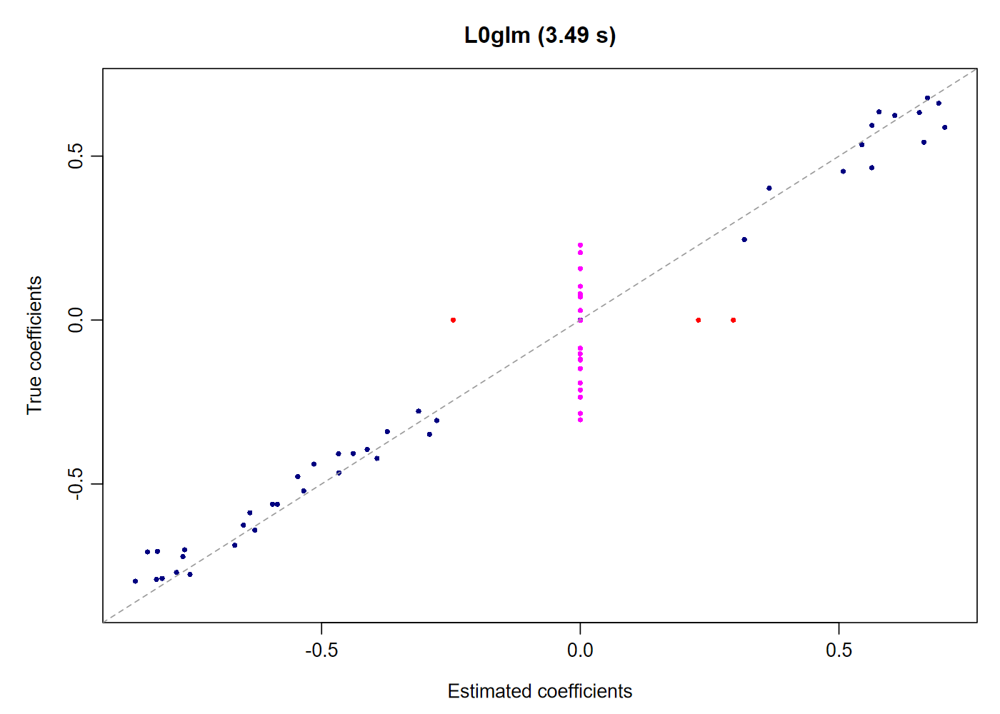
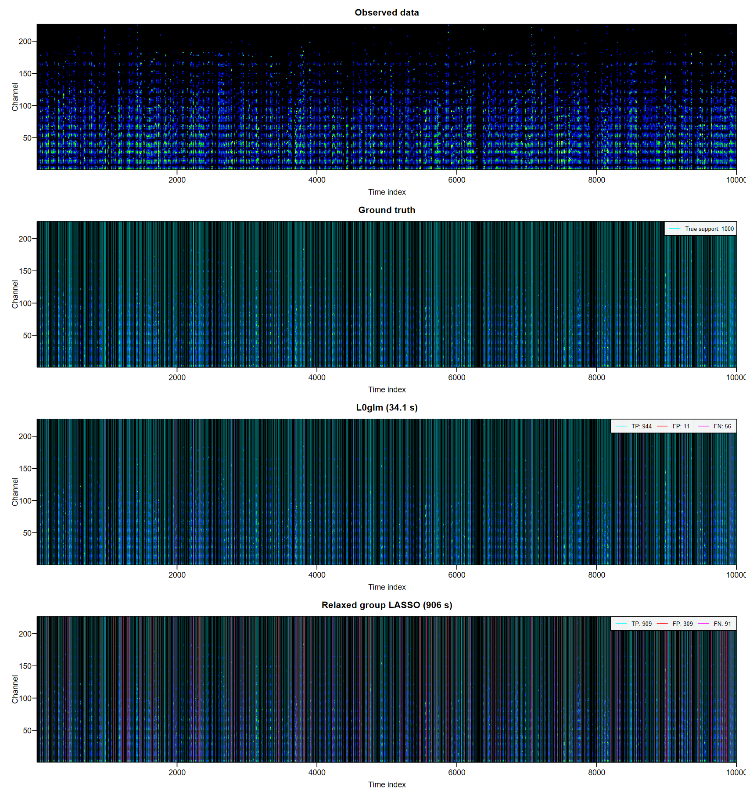
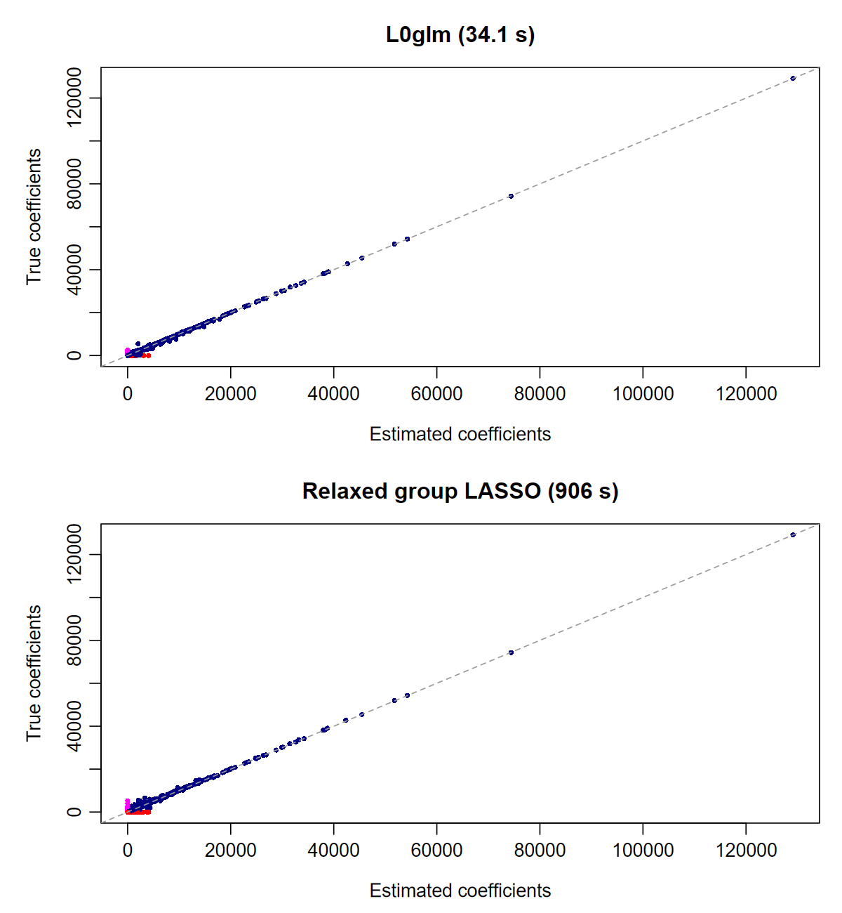
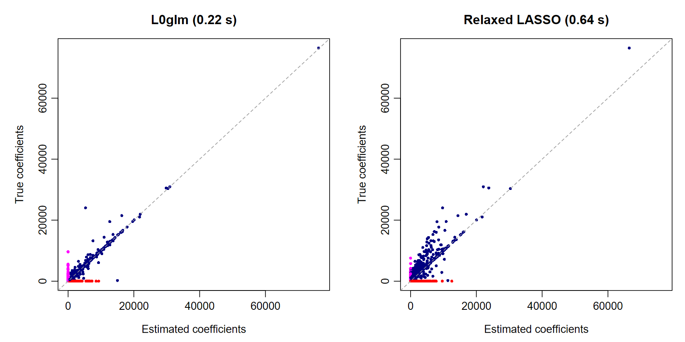

<!-- README.md is generated from README.Rmd. Run Rscript benchmarks/render_readme.R. -->

<picture>
  <source media="(prefers-color-scheme: dark)" srcset="L0glm/man/figures/logo-dark.svg">
  <source media="(prefers-color-scheme: light)" srcset="L0glm/man/figures/logo-light.svg">
  
</picture>

# L0glm: fast sparse regression for generalized linear models

[Documentation and tutorials](https://tomwenseleers.github.io/L0glm/) · [Function reference](https://tomwenseleers.github.io/L0glm/reference/index.html)

`L0glm` fits **L0-penalized and grouped L0-penalized models** for best subset and
best subset of groups selection. It combines adaptive ridge with IRLS, fast
linear solvers and an optional relaxed refit to obtain sparse, low-bias estimates.
Strong signals receive progressively less shrinkage as the fit concentrates on
the active predictors, giving accurate coefficients with few false positives.
It is highly efficient, with fitting often being one or two orders of magnitude
faster than `glmnet` - the most widely used sparse regression framework - and
it is shown to return solutions with far fewer false positives with similar or better
predictive power and sensitivity than other competing sparse regression methods, like 
LASSO, adaptive LASSO, relaxed LASSO, MCP or SCAD. For most problems, performance
in terms of speed and quality of the solution obtained is also superior to that
of other packages aimed at best subset selection, such as abess and L0Learn.

The [Algorithm & theory guide](https://tomwenseleers.github.io/L0glm/articles/algorithm.html)
explains the mathematics, regularization presets and full fitting algorithms.

- **Families:** standard GLMs and their links, negative binomial with estimated
  shape, joint multinomial logistic regression, and right-censored Cox PH.
- **Data:** dense or sparse, tall or wide designs; single or multiple responses;
  grouped row selection; SIS/ISIS screening for ultrahigh dimensions.
- **Controls:** observation weights, offsets, unpenalized terms, starting values,
  normalization, original-scale coefficients and optional nonnegativity constraints.
- **Selection:** a fast GIC preset, information-criterion path selection, or
  cross-validation with minimum-deviance and one-standard-error models.
- **Comparison:** `sparseglm()` benchmarks L0glm, ABESS, L0Learn, LASSO, relaxed
  and adaptive LASSO, MCP and SCAD where their backends support the requested model.

## Installation

```r
install.packages("remotes")
remotes::install_github("tomwenseleers/L0glm", subdir="L0glm")
```

The source package is in `L0glm/`. Windows source installation requires
[Rtools](https://cran.r-project.org/bin/windows/Rtools/).
The special-family examples use `mgcv`; Cox also uses `survival`.

## A one million predictor example

In this example there are sixty nonzero effects among **one million predictors**, while
we have only 500 observations. Fitting this high dimensional dataset on a laptop takes just a single
call and completes in just **3 seconds**, and recovers **40 out of 60 nonzero coefficients** with
just **3 false positives**:

```r
library(L0glm)
set.seed(123)
n <- 500L
p <- 1000000L
X <- matrix(rnorm(n*p), n, p)
active <- sample.int(p, 60L)
beta <- numeric(p)
beta[active] <- runif(60L, -.8, .8)
set.seed(1)
y <- as.numeric(X[, active] %*% beta[active]) + rnorm(n)

system.time(fit <- L0glm.fit(X, y, family=gaussian()))
L0glm.metrics(fit, beta_true=beta)[
  c("gic", "TP", "FP", "FN", "TN", "F1_score", "MCC")]
```

<!-- BEGIN million-comparison -->
| Method | Selection | Seconds | GIC | TP | FP | FN | TN | F1 | MCC |
| --- | --- | ---: | ---: | ---: | ---: | ---: | ---: | ---: | ---: |
| **L0glm + ISIS** | **GIC preset** | **3.49** | **2583** | **40** | **3** | **20** | **999937** | **0.777** | **0.787** |
| LASSO | BIC path | 22.75 | 14789 | 23 | 612 | 37 | 999328 | 0.066 | 0.118 |
| Relaxed LASSO | BIC path | 21.42 | 10588 | 21 | 453 | 39 | 999487 | 0.079 | 0.124 |
| LASSO | 5-fold CV | 123.13 | 4309 | 17 | 50 | 43 | 999890 | 0.268 | 0.268 |
| Relaxed LASSO | 5-fold CV | 91.76 | 7413 | 20 | 252 | 40 | 999688 | 0.120 | 0.156 |
<!-- END million-comparison -->

<!-- BEGIN million-speed -->
L0glm is **35× faster than five-fold-CV LASSO** in this comparison, with higher sensitivity and fewer false positives.
<!-- END million-speed -->
L0glm uses a single GIC preset and a relaxed refit. LASSO and fully relaxed
LASSO search up to 40 lambda values using BIC or five-fold CV. BIC is included
because GIC can select a null LASSO model at this dimension; all methods are
also evaluated with the same GIC. CV uses common random folds.

Recovered coefficients show near-zero bias:



The dense design occupies about 4 GB. The [getting-started guide](https://tomwenseleers.github.io/L0glm/articles/L0glm.html)
explains the example and prediction methods.

For high dimensional datasets like this, **ISIS** (Iterative Sure Independence
Screening) is used to iteratively add promising predictors for joint sparse fitting.
The default `screen="auto"` enables ISIS exactly when `p_eligible > 10*n`.
Eligible predictors exclude mandatory terms and predictors excluded by zero
starts in every response channel. Screening uses all physical cores by default.
`L0glm.tune()` applies the same rule separately to each full-data or CV training
fit, using its training row count. See the
[high dimensional tutorial](https://tomwenseleers.github.io/L0glm/articles/high-dimensional.html) for the details.

## Application: sparse deconvolution

In **GC/MS analysis**, overlapping chromatographic peaks have distinct mass
spectra. Recovering their peak times and spectra together is a natural application
of grouped L₀ regression. This Poisson simulation has **10,000 observations,
10,000 candidate peak locations, 1,000 true peaks and 226 mass channels**.

By regressing the observed signal on a design matrix consisting of shifted
copies of the peak-shape function (or "point spread function"), L0glm recovers
the underlying peaks and their mass spectra in a highly efficient and accurate way.

<!-- BEGIN multi-speed -->
In this 2,26 million coefficient example, L0glm recovers **944 of 1,000 true peaks 
with just 11 false positives** in **9.63 seconds**: **25× faster than GIC-tuned 
group LASSO** and **332× faster than relaxed group LASSO tuned by five-fold CV** 
in this comparison, while also boasting a much reduced false-positive rate (0.11% vs. 
3.09% for GIC tuned relaxed group LASSO).
<!-- END multi-speed -->
It also recovers the sparse sparse mass spectra accurately, with a within-row F1 of
**0.909** and within-row MCC (Matthews Correlation Coefficient) of **0.864**. 
A direct `L0glm.fit()` call uses `lambda="gic"` and four cores;
the competing methods select lambda from a ten-value grid using GIC or
five-fold cross-validation.

```r
multi <- simul(method=4L, n=10000L, p=10000L,
  n_nonzero=1000L, seed=2L)
fit_multi <- L0glm.fit(multi$X, multi$y, family=poisson("identity"),
  lambda="gic", nonnegative=TRUE, ncores=4L)
```

<!-- BEGIN multi-home -->
| Method | Selection | Seconds | GIC | TP | FP | F1 | MCC |
| --- | --- | ---: | ---: | ---: | ---: | ---: | ---: |
| L0glm | GIC preset | 9.63 | 5615963 | 944 | 11 | 0.966 | 0.962 |
| Group LASSO | GIC path | 244.87 | 7413616 | 980 | 860 | 0.690 | 0.685 |
| Relaxed group LASSO | GIC path | 906.34 | 6138687 | 909 | 309 | 0.820 | 0.802 |
| Group LASSO | 5-fold CV | 813.42 | 9639345 | 998 | 4242 | 0.320 | 0.316 |
| Relaxed group LASSO | 5-fold CV | 3199.62 | 6198648 | 962 | 502 | 0.781 | 0.769 |
<!-- END multi-home -->



The coefficient comparison shows how closely L0glm recovers the individual
mass-spectral intensities. GIC tuned relaxed group LASSO is the strongest alternative in
this benchmark, but is 94 times slower and has a 28 times higher false positive rate.



L0glm fits the multivariate Poisson model directly. The group-LASSO methods use a
weighted-Gaussian approximation with shared observation weights; CV uses four
parallel workers. [Explore the deconvolution examples and full
benchmark tables →](https://tomwenseleers.github.io/L0glm/articles/deconvolution.html)

<details>
<summary><strong>Single channel deconvolution</strong></summary>

The single-channel Poisson example also has **10,000 observations, 10,000
candidate peak locations and 1,000 true peaks**.

```r
single <- simul(method=2L, n=10000L, p=10000L,
  n_nonzero=1000L, seed=2L)
fit_single <- L0glm.fit(single$X, single$y, family=poisson("identity"),
  lambda="gic", nonnegative=TRUE, relaxed=TRUE)
```

<!-- BEGIN single-speed -->
L0glm recovers **845 of 1,000 true peaks with just 154 false positives** in **0.20 seconds**: **2× faster than GIC-tuned LASSO** and **34× faster than relaxed LASSO tuned by five-fold CV** in this comparison.
<!-- END single-speed -->

<!-- BEGIN single-metrics -->
| Method | Selection | Seconds | GIC | TP | FP | FN | TN | F1 | MCC |
| --- | --- | ---: | ---: | ---: | ---: | ---: | ---: | ---: | ---: |
| L0glm | GIC preset | 0.20 | 102682 | 845 | 154 | 155 | 8846 | 0.845 | 0.828 |
| LASSO | GIC path | 0.40 | 145904 | 950 | 2096 | 50 | 6904 | 0.470 | 0.467 |
| Relaxed LASSO | GIC path | 0.64 | 122083 | 905 | 999 | 95 | 8001 | 0.623 | 0.607 |
| LASSO | 5-fold CV | 4.83 | 146234 | 951 | 2146 | 49 | 6854 | 0.464 | 0.462 |
| Relaxed LASSO | 5-fold CV | 6.70 | 133122 | 920 | 1523 | 80 | 7477 | 0.534 | 0.524 |
<!-- END single-metrics -->



LASSO and relaxed LASSO use Gaussian weighted least squares with observation
weights `1/(y+0.1)`. They search ten lambda values using GIC or five-fold CV;
L0glm uses one GIC preset. The [deconvolution tutorial](https://tomwenseleers.github.io/L0glm/articles/deconvolution.html)
also shows a readable zoom of the observed and fitted signals.

</details>

## Model selection and special families

An automatic preset such as `lambda="gic"` typically provides a near-optimal
sparse solution straight away. Tuning over a lambda grid or cross-validation
remains available to refine regularization or optimize out-of-sample prediction.

```r
gic <- L0glm.tune(multi$X, multi$y, family=poisson("identity"),
  tune="gic", nlambda=10L, nonnegative=TRUE, grouped=TRUE, relaxed=TRUE)
cv <- L0glm.tune(multi$X, multi$y, family=poisson("identity"),
  tune="cv", nfolds=5L, nlambda=10L,
  nonnegative=TRUE, grouped=TRUE, relaxed=TRUE)
coef(cv$fit_1se)
predict(cv$fit_best, newdata=multi$X, type="response")
```

CV returns `lambda_best`, `lambda_1se`, `fit_best` and `fit_1se`, with both
models refitted on all observations. Plots show coefficient paths and mean
validation deviance ± one standard error.

The same interface supports negative binomial, joint multinomial and Cox
models. These small sparse simulations show a preset, GIC tuning and five-fold
CV for each family:

```r
fit_and_tune <- function(data) {
  args <- list(X=data$X, y=data$y, family=data$family,
    intercept=data$intercept, relaxed=TRUE, maxit=100L)
  list(preset=do.call(L0glm.fit, c(args, list(lambda="gic"))),
    gic=do.call(L0glm.tune, c(args, list(tune="gic", nlambda=10L))),
    cv=do.call(L0glm.tune, c(args, list(tune="cv", nfolds=5L, nlambda=10L))))
}

nb <- fit_and_tune(simul("normal", n=300L, p=20L, n_nonzero=3L,
  family=mgcv::nb(), intercept=1, options=list(theta=2), seed=31L))
multinomial <- fit_and_tune(simul("normal", n=300L, p=20L, n_nonzero=3L,
  family=mgcv::multinom(K=2), intercept=c(.3, 0, -.3), seed=32L))
cox <- fit_and_tune(simul("normal", n=300L, p=20L, n_nonzero=3L,
  family=mgcv::cox.ph(), seed=33L))
fitted(multinomial$cv$fit_1se)  # category probabilities
```

Negative binomial models accept counts, multinomial models accept factors or
category-count matrices, and Cox models accept `survival::Surv(time, status)`.
Multinomial coefficients use zero-sum CLR contrasts; Cox predictions give
relative risks.

## Choose a starting point

| I would like to… | Start here |
|---|---|
| Fit a model and make predictions | [Get started](https://tomwenseleers.github.io/L0glm/articles/L0glm.html) |
| Choose a penalty by GIC or cross-validation | [Model selection](https://tomwenseleers.github.io/L0glm/articles/selection.html) |
| Use weights, constraints or held-out early stopping | [Fitting controls](https://tomwenseleers.github.io/L0glm/articles/controls.html) |
| Fit counts, classes or survival outcomes | [Negative binomial](https://tomwenseleers.github.io/L0glm/articles/negative-binomial.html) · [Multinomial](https://tomwenseleers.github.io/L0glm/articles/multinomial.html) · [Cox](https://tomwenseleers.github.io/L0glm/articles/cox.html) |
| Search a very large predictor set | [SIS / ISIS](https://tomwenseleers.github.io/L0glm/articles/high-dimensional.html) |
| Understand the mathematics | [Algorithm & theory](https://tomwenseleers.github.io/L0glm/articles/algorithm.html) |
| Compare speed and support recovery | [Benchmarks](https://tomwenseleers.github.io/L0glm/articles/performance.html) |

## Foundations

The method builds on adaptive ridge and broken adaptive ridge, with an IRLS
implementation for generalized linear models. The [algorithm article](https://tomwenseleers.github.io/L0glm/articles/algorithm.html)
develops the quadratic updates and their connection to sparse penalties, drawing
on [Frommlet & Nuel (2016)](https://doi.org/10.1371/journal.pone.0148620),
[Li et al. (2021)](https://doi.org/10.1016/j.jspi.2020.12.001) and
[Abergel, Bouaziz & Nuel (2024)](https://doi.org/10.1007/s11222-024-10440-6).
It also explains screening, grouped selection and likelihood-based scoring.
The adaptive updates also have a [hierarchical Bayesian and automatic relevance
determination (ARD) interpretation](https://tomwenseleers.github.io/L0glm/articles/algorithm.html#a-hierarchical-bayesian-and-ard-view):
each ridge step estimates a Gaussian-prior MAP, then the prior scales adapt to
the fitted effects. Zero-centered skeptical priors tighten around small effects
and relax around strong ones.

## Benchmarks and reproducibility

These tables and figures use the same measurements as the
[website benchmarks](https://tomwenseleers.github.io/L0glm/articles/performance.html). They were run on an
**HP ZBook Fury 17.3-inch G8 Mobile Workstation**, with an **Intel Core i9-11950H
at 2.60 GHz, 8 physical cores and 16 logical cores**, using Windows,
R 4.5.0 and OpenBLAS with one BLAS thread.

L0glm timings are medians of three matching fits. The million-predictor example
uses eight screening threads. Multichannel deconvolution uses four fitting
threads, and deconvolution CV uses four parallel workers, including worker
startup and the full-data refit in its timings. The million-predictor LASSO
comparison uses the common-scoring CV loop with serial folds. Simulation and
final metric reporting are excluded. Known coefficient truth is used only to
evaluate recovery.

- [Website benchmark runner](benchmarks/benchmark_website_examples.R): GIC-preset fits and deconvolution comparisons.
- [Million-predictor LASSO comparison](benchmarks/benchmark_million_lasso.R): BIC and five-fold CV workflows.
- [Published measurements and plotting instructions](benchmarks/plots/website/README.md).
- [Fit examples](L0glm/examples/L0glm.fit.R) and [tuning examples](L0glm/examples/L0glm.tune.R).

Run `Rscript benchmarks/render_readme.R` to regenerate this README from the
shared published benchmark tables and figures. To obtain new measurements,
run the benchmark scripts first.

## Citation

An article describing the methods implemented in L0glm is in preparation.
If you use the package before the article is formally published, we would
appreciate a citation to the package:

Wenseleers T, Lanzas L, Vanderaa C (2026).
*L0glm: Fast Sparse Regression for Generalized Linear Models*.
R package version 0.1.0,
<https://tomwenseleers.github.io/L0glm/>.

The [Authors and Citation page](https://tomwenseleers.github.io/L0glm/authors.html#citation) also provides the
citation in BibTeX format.

## Acknowledgements

OpenAI Codex, using GPT-6 Astra and GPT-6.1 Sol, was used to optimize and
refactor code and help draft the documentation. The key ideas and methodological
decisions are the authors' own, and the authors take full responsibility for the
work presented here.
