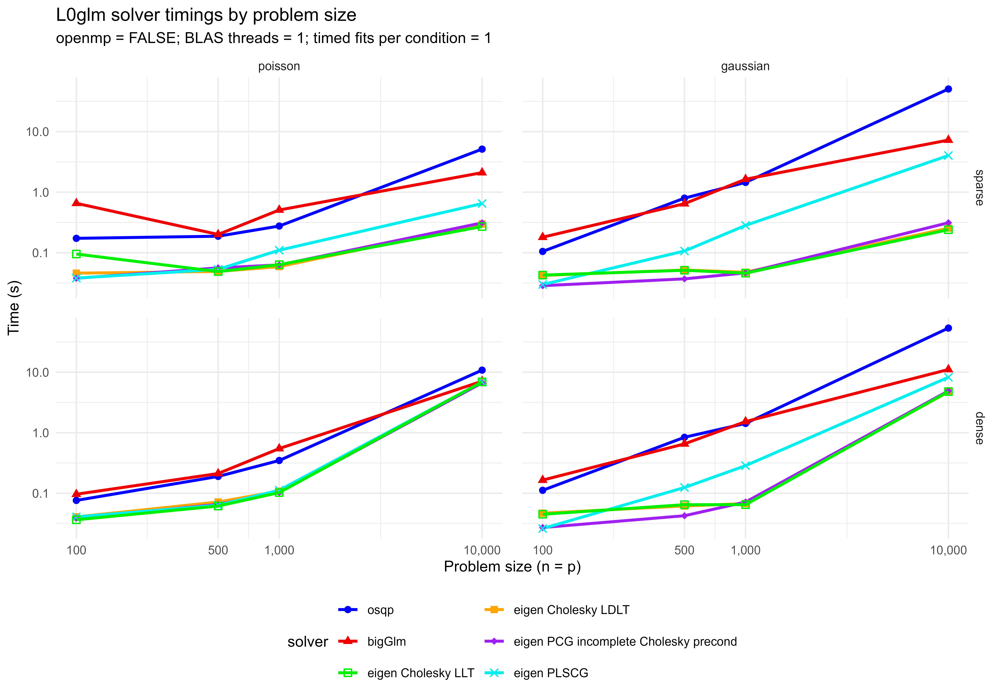

# Timing and solution follow-up, 17 October 2026

Source commit `2770dfc` restores `maxit=25, tol=1e-10` in both fitters. The
preceding defaults allowed 200 iterations at tolerance `1e-8`. These budgets
produce different intermediate adaptive-ridge fits, even for Poisson with its
fixed dispersion of one. Additional iterations can improve the fitted objective
without improving recovery of the noiseless signal.

The Gaussian dispersion initializer also spent substantial time forming a dense
cross-product for a dense-stored PSF design containing mostly exact zeros. It now
uses sparse row augmentation for that auxiliary ridge system when beneficial.
The ridge matrix is mathematically unchanged, and the main design retains its
original storage. In a controlled two-repeat comparison with 25 outer iterations,
the dense Gaussian LLT fit fell from 21.435 to 4.810 seconds without a material
change in its metrics. This is separate from the reduction in the outer budget.

## Benchmark design

The original benchmark script was run from the checkout, with its output directed
to `codex_sandbox/start_coordinates_timing/solver_grid_after`. The user's current
outputs and `old_plots` were retained. Each of the 96 combinations uses the same
simulation seed, starting coefficients, GIC penalty and problem dimensions as the
script. All solvers use the general R fitting loop: `openmp=FALSE`, one BLAS thread,
25 outer iterations, tolerance `1e-10`, and one high-resolution timed fit. The
plot draws green LLT lines and points last.

The full grid is a one-repeat comparison; small differences are not reliable
speed rankings, particularly for very short fits and initial package/JIT work.
Selected timings were repeated separately. All 96 fits returned usable metrics,
but 69 reached the outer iteration limit. An available fit is not evidence of
convergence. Inspect `Iterations`, `Converged`, `Warnings` and `Status` in
[`metrics_after.csv`](metrics_after.csv).

The [`comparison_old_before_after.csv`](comparison_old_before_after.csv) joins
three saved runs on family, storage, size and solver:

- `old`: the user's `old_plots` results.
- `before`: the user's newer results before restoring the iteration defaults.
- `after`: this rerun with the source changes above.

Representative timings for n=p=10,000, in seconds:

| Noise | Input storage | Solver | Old | Before | After |
|---|---|---|---:|---:|---:|
| Poisson | sparse | LLT | 0.242 | 1.352 | 0.271 |
| Poisson | dense | LLT | 7.619 | 25.571 | 6.915 |
| Gaussian | sparse | LLT | 0.210 | 1.057 | 0.240 |
| Gaussian | dense | LLT | 3.949 | 35.890 | 4.783 |
| Poisson | sparse | CG | 0.267 | 0.925 | 0.311 |
| Poisson | dense | CG | 6.821 | 13.983 | 6.643 |
| Gaussian | sparse | CG | 0.298 | 0.320 | 0.312 |
| Gaussian | dense | CG | 3.705 | 20.489 | 4.909 |

Poisson metrics reproduce the old table to numerical precision. Gaussian
LLT/LDLT support sizes and F1 agree with the old table; at n=10,000 their
deviance against truth per observation changes by only about 3.1e-6. The main
remaining quality exception at the unchanged inner solver defaults is dense
Gaussian CG, discussed below. The CSV reports every metric difference, including
the less favorable cases.



## Native single-channel Poisson example

Benchmark 2's default LLT dispatch uses the native implementation. Five repeated
fits now take a median 0.14 seconds (range 0.11--0.27), with 1,011 selected
coefficients, observed deviance 9,349.100368, deviance against noiseless truth
2,988.750179, GIC 102,746.973319, F1 0.8383889 and MCC 0.8203380. This reproduces
the earlier 25-iteration result. The previous 200-iteration default took about
0.33 seconds and selected 1,007 coefficients. Neither budget was reported as
converged in this example.

This 0.14-second native example and the general-loop solver grid above use
different implementations; compare timings within the same route. Repeated
targeted timings and the controlled iteration-budget comparison are saved as
[`repeated_targeted_timings.csv`](repeated_targeted_timings.csv) and
[`controlled_iteration_comparison.csv`](controlled_iteration_comparison.csv).
In the latter file, `legacy` means 25/1e-10, `current` means the preceding
200/1e-8 defaults, and `looser` means 200/1e-6. These controlled runs preceded
the Gaussian pilot cross-product optimization.

## CG preconditioning and inner accuracy

An earlier implementation change replaced sparse incomplete Cholesky with
diagonal preconditioning **for dense CG systems**. The comparison is recorded
under `codex_sandbox/fitting_revision/dense_CG_benchmark.csv`: diagonal
preconditioning was faster than a dense Cholesky preconditioner on the three
tested systems, with relative residuals below 1e-10.

The default timing benchmark follows another route. With `rowaug=TRUE`, its
penalized, non-wide systems are augmented into sparse storage, and CG continues
to use incomplete Cholesky. Tracing the 500-variable Gaussian benchmark with
both dense and sparse inputs confirmed `dgCMatrix`, `precond=2` at every solve;
see [`cg_routes.csv`](cg_routes.csv). Dense Woodbury systems and dense solves
without row augmentation use diagonal CG.

The unchanged inner tolerance of 1e-7 can nonetheless affect an ill-conditioned
adaptive-ridge trajectory. For a linear system A beta = b and residual
r = b - A beta_hat,

    ||beta_hat - beta|| / ||beta|| <= kappa(A) ||r|| / ||b||.

Thus a small relative residual need not imply equally small coefficient error.
The next inverse-square adaptive penalties and hard support decisions can
amplify differences near zero. This is distinct from changing the preconditioner
or the outer-loop tolerance.

In additional Gaussian checks, inner tolerance 1e-10 makes CG closely match LLT:
at n=500 (dense), truth deviance/n changes from 1.411543 to approximately
1.018139, with F1 0.878505. At n=10,000 (dense), it changes from 3.247432 to
approximately 1.181553, with F1 0.937348. The sparse n=10,000 fit reaches the
same tighter result. These are tested examples, not a guarantee for every
nonconvex path. The default remains 1e-7; use the more accurate option explicitly:

```r
fit <- L0glm.fit(
  X, y, family=gaussian(), nonnegative=TRUE,
  solver="eigen", method=3L,
  control.solver=control.solver.gen("eigen", 3L, tol=1e-10),
  maxit=25, tol=1e-10
)
```

Three-repeat timings, coefficient metrics and objective values for the two
inner tolerances are in
[`cg_tolerance_comparison.csv`](cg_tolerance_comparison.csv). Increasing inner
accuracy costs additional CG iterations; the sparse fit is especially sensitive
in relative timing terms. At n=10,000, median times change from 6.08 to 6.87
seconds for dense input and from 0.30 to 0.73 seconds for sparse input. Each
configuration returned identical coefficients across its three repetitions.
Tolerance 1e-12 was also checked in the local probe and changed these tighter
results only slightly.

## Validation and use

The package test suite passed 2,276 assertions, with zero failures, errors,
skips or test warnings. The QSAR normalization/start follow-up independently
recomputed every GIC and held-out RMSE and replayed saved starts. Scratch
scripts, detailed logs and models remain under the ignored `codex_sandbox`.

The installed package could not be updated while its DLL was in use by another
R process. Restart the RStudio R session and reinstall, or load this checkout
with `pkgload::load_all("L0glm", compile=FALSE)` from the repository root when
its existing native library is available. The results here use the checkout.
