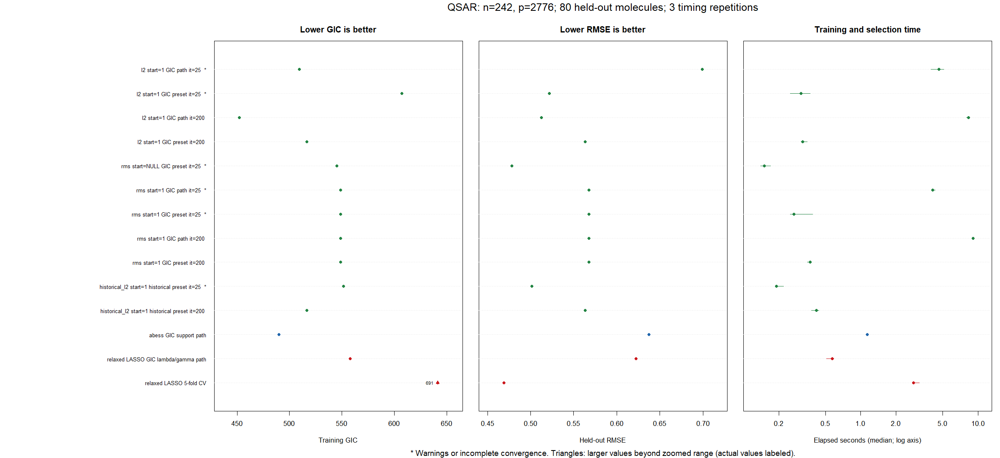

# QSAR normalization, starting coordinates and iteration budgets

Run `benchmark L0glm vs abess and relaxed LASSO.R` from the repository root,
the `L0glm` package directory, or this benchmark directory. Edit `cfg` at the top.
The default loads the checkout with `pkgload::load_all(..., compile = FALSE)`;
build its native code first if necessary. Set `load_checkout = FALSE` to use the
installed package. Dependencies are checked and are not installed automatically.

The main comparisons use the same seed-1 outcome-stratified split: 242 training
and 80 held-out molecules. Near-invariance filtering uses training covariates,
leaving 2,776 predictors. All main preprocessing, pilot construction, parameter
estimation and CV selection use training observations only. Held-out outcomes
are used only for final scoring.

## Normalization and starts

Gaussian models have signed slopes and a free intercept. These normalization
choices are passed to L0glm:

| `normalize` | Training working column |
|---|---|
| `"none"` | Original column, no scaling |
| `"l2"` | Centered column with L2 norm 1 |
| `"rms"` | Centered column with L2 norm $\sqrt n$ |
| `"sd"` | Centered column with sample SD 1; L2 norm $\sqrt{n-1}$ |
| `"auto"` | Resolves to `"rms"` for these signed Gaussian fits |

The four starts are:

- `NULL`: automatic initialization for each independent fit.
- Numeric scalar `1`: ones in **normalized working coefficient coordinates**.
- `original_ones`: an explicit matrix of ones in original descriptor units.
- `"pilot"`: a common seed from ten independent unrelaxed fits between lambda
  2 and the GIC preset, pooled by signed mean absolute magnitude. Its zero
  entries restrict eligibility; it retains the union of pilot supports.

For $Z_j=(X_j-c_j)/s_j$, the coefficient relation is

$$
\theta_j=s_j\beta_j,\qquad
\theta_0=\alpha+\sum_j c_j\beta_j.
$$

Consequently, scalar `start=1` means $\beta_j^{(0)}=1/s_j$ and
$\alpha^{(0)}=1-\sum_j c_j/s_j$. All other scalar starts and all explicit
vectors/matrices remain in original units. A matrix also distinguishes original
ones from the shorthand in a one-term model. With `normalize="none"`, the two
unit-start conventions coincide. Nonnegative PSF deconvolution retains its
peak-amplitude convention: `normalize="auto"` resolves to `"none"` there.

The package defaults are restored to `maxit=25, tol=1e-10`. L2 and RMS scalar-one
starts are additionally tested with `maxit=200`, at the same tolerance. A model
can stop at its iteration limit without converging; the table records this.
The L0glm models are unrelaxed by default. Set `cfg$relaxed=c(FALSE,TRUE)` to
compare relaxed refits too.

Each combination has a GIC-preset fit and a ten-point GIC path. The path includes
lambda 2, the preset and a verified numerical zero-support endpoint. Endpoints
are determined separately, so intermediate grid values can differ by variant.
Every lambda is fitted independently; no preceding path fit supplies a start.
The same scalar-one convention applies separately within CV training folds.

## Historical reference

Two separately labeled `historical_l2` rows reproduce the original script's
centering/L2 normalization using all covariate rows before splitting, then fit
with original-coordinate ones, `normalize="none"`, and 25 or 200 iterations.
This uses no test outcomes, but differs from the strictly training-derived
preprocessing of the main comparisons. It is included only to compare with the
user's original good QSAR solution. Coefficients are transformed back to raw
descriptor units for common scoring. Disable it with
`cfg$historical_reference=FALSE`.

## Competitors and common scores

The competitors use signed slopes and a free intercept:

- **abess** uses its training normalization, support sizes 0 through $n-1$,
  one thread, and `warm.start=FALSE`. Its path is rescored by the common GIC.
- **Relaxed LASSO selected by GIC** searches its lambda path and gamma values
  0, 0.5 and 1; gamma 0 is fully relaxed, and gamma 1 is ordinary LASSO.
- **Relaxed LASSO selected by five-fold CV** chooses lambda/gamma using training
  observations only, with saved folds reused across timing repetitions.

Every fitted model is evaluated using the same profiled Gaussian criterion:

$$
\widehat\sigma^2_{ML}=RSS_{train}/n,\qquad
GIC=n[\log(2\pi)+1+\log(RSS_{train}/n)]
       +\log(p)\log\log(n)\,(k+2).
$$

Here $k$ counts nonzero slopes; the extra two parameters are the intercept and
variance. The original $p=2776$ is retained after support restrictions. The GIC
preset is approximately 13.500586. The script independently checks the formula
against the package scorer. Exact interpolants have unbounded profiled Gaussian
likelihood and are excluded from finite-GIC path selection with a warning.
This score is not an effective-ridge-df correction or a global L0 certificate.

Held-out RMSE is $\sqrt{\operatorname{mean}((y_{test}-\widehat y_{test})^2)}$.
The test scores do not select any fitted model. Comparing many configurations
on this one split remains exploratory.

Reported seconds are medians of three complete procedures with one BLAS/OpenMP
thread. They exclude package loading, common data preparation, test scoring and
file/plot output. Path times include endpoint search, pilots and selection;
preset times include pilot construction when used. LASSO CV times include its
full training path, fold fits and relaxed refits.

## Outputs and reproduction

`results_normalization_start/` contains `comparison.csv`, every repetition in
`runs.csv`, zoomed and full-range figures, the exact split and predictor map,
and `sessionInfo.txt`. `completed_runs` counts procedures returning a model;
`clean_runs` additionally requires no warnings and reported convergence.
The main figure labels values beyond its zoomed range as triangles. The
full-range figure uses logarithmic RMSE and time axes. Asterisks mark warnings
or iteration-limit stops.

The local `models.rds` contains fitted models, full paths, seeds and configuration;
it is excluded from Git. After running the script, replay a pilot-seeded fit with:

```r
saved <- readRDS(file.path(out_dir, "models.rds"))
tuned <- saved$paths[["L0glm_rms_pilot_unrelaxed_iter25"]]
replayed <- do.call(L0glm.fit, c(
  list(X=X_train, y=y_train, lambda=tuned$lambda_best), tuned$fit_args
))
```

The preceding 200-iteration/original-coordinate-unit comparison remains in Git
commit `3cd47ab`. Local investigation scripts and snapshots are under
`codex_sandbox/start_coordinates_timing/`.

## Results from 17 October 2026

All 49 variants were timed three times (147 completed procedures). The following
preset comparisons isolate the requested normalized unit starts:

| Start/input convention | Budget | Slopes | GIC | Test RMSE | Seconds |
|---|---:|---:|---:|---:|---:|
| RMS, automatic start | 25 | 7 | 545.02 | 0.47818 | 0.15 |
| Training L2 norm 1, scalar unit start | 25 | 15 | 607.36 | 0.52153 | 0.31 |
| Training L2 norm 1, scalar unit start | 200 | 6 | 516.44 | 0.56345 | 0.32 |
| Training L2 norm sqrt(n), scalar unit start | 25 | 6 | 548.81 | 0.56787 | 0.27 |
| Training L2 norm sqrt(n), scalar unit start | 200 | 6 | 548.78 | 0.56769 | 0.37 |
| Original all-row L2 transformation, original-unit ones | 25 | 14 | 551.66 | 0.50125 | 0.19 |
| Original all-row L2 transformation, original-unit ones | 200 | 6 | 516.44 | 0.56345 | 0.42 |
| abess, GIC path | -- | 12 | 489.83 | 0.63720 | 1.14 |
| Relaxed LASSO, GIC lambda/gamma path | -- | 2 | 558.01 | 0.62235 | 0.57 |
| Relaxed LASSO, five-fold CV | -- | 24 | 690.71 | 0.46923 | 2.81 |

The historical reference closely reproduces the original good result (earlier
test RMSE approximately 0.50108). Increasing its iteration budget lowers GIC
while worsening held-out prediction. A lower training GIC is not a guarantee
of better prediction on this particular split.

Training-only normalization and normalized-coordinate unit starts are different
initial models from original-unit ones on the original globally transformed
input. The normalization mode also controls automatic dispersion initialization
and threshold coordinates. Thus matching the phrase "start=1" alone does not
reproduce the old fitting recipe.

The ten-point GIC search gives another tradeoff. L2 unit starts with 200
iterations select lambda approximately 9.21485, ten slopes, GIC 452.29 and RMSE
0.51251, taking 8.33 s. With 25 iterations, that path selects lambda approximately
33.18945, three slopes, GIC 509.24 and RMSE 0.69907. RMS unit starts select the
preset on the evaluated grid at both budgets. These are heuristic path results,
not global optimality claims. Iteration-limit stops are explicitly marked.



The [complete comparison](results_normalization_start/comparison.png) also
includes every automatic, pilot and original-coordinate-one configuration.

References: [abess arguments](https://abess-team.github.io/abess/reference/abess.html)
and [glmnet relaxed LASSO](https://glmnet.stanford.edu/articles/relax.html).
