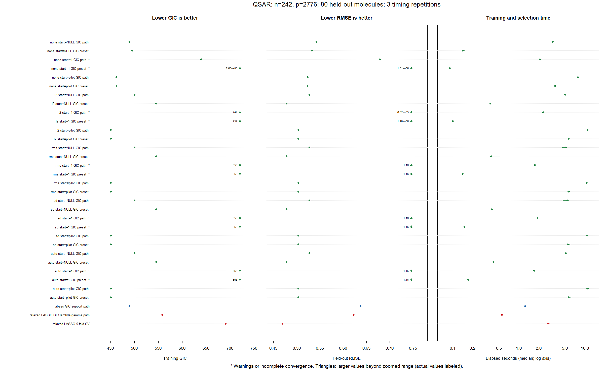

# QSAR normalization and initialization benchmark

Run `benchmark L0glm vs abess and relaxed LASSO.R` from the repository root,
the `L0glm` package directory, or this benchmark directory. Edit the ordinary
values in `cfg` at the top of the script. By default it loads the checkout
with `pkgload::load_all(..., compile = FALSE)`; build the package's native code
first if necessary. Set `load_checkout = FALSE` to use the installed package.
No packages are installed automatically.

The supplied molecular data give 242 training and 80 held-out observations.
The original seed-1, outcome-stratified split is retained. Near-invariance
filtering is learned from training observations, leaving 2,776 predictors.
Raw descriptors are passed to each method; no full-dataset centering or scaling
is performed. This corrects the earlier script, which transformed descriptors
before splitting and included the test outcomes in relaxed-LASSO CV.

## Comparisons

L0glm uses Gaussian identity-link regression, signed slopes, a free intercept,
Eigen Cholesky LLT (`method = 1L`), and these internal normalization modes:

| `normalize` | Training working column, with free intercept |
|---|---|
| `"none"` | Original column, no scaling |
| `"l2"` | Centered column with L2 norm 1 |
| `"rms"` | Centered column with L2 norm $\sqrt n$ |
| `"sd"` | Centered column with sample SD 1; L2 norm $\sqrt{n-1}$ |
| `"auto"` | Resolves to `"rms"` for these signed Gaussian fits |

The starting options are `NULL`, scalar `1`, and `"pilot"`. A scalar one is in
the **original input coefficient units**, not a vector of ones in normalized
coordinates. A pilot seed pools ten independent unrelaxed fits between lambda
2 and the GIC preset: mean absolute magnitude, with the sign of the mean and a
largest-magnitude tie rule. It retains the union of their supports. This is a
common start for independent fits at each requested lambda, not a sequential
warm start. Its zero entries restrict eligibility. Seeds and fitting arguments
are retained in `models.rds` for reproduction.

For example, after running the benchmark, replay a pilot-seeded tuned fit with:

```r
saved <- readRDS(file.path(out_dir, "models.rds"))
tuned <- saved$paths[["L0glm_rms_pilot_unrelaxed"]]
replayed <- do.call(L0glm.fit, c(
  list(X = X_train, y = y_train, lambda = tuned$lambda_best), tuned$fit_args
))
```

Each combination has two results: the fixed GIC-preset fit and the best training
GIC on a ten-point path. The preset provides a comparison at exactly the same
lambda. The path includes lambda 2, the preset, and a verified zero-support
endpoint; that endpoint is determined separately for each variant, so the
other lambda grid values can differ. By default L0glm is unrelaxed, as in the
original benchmark. Set `cfg$relaxed = c(FALSE, TRUE)` to also compare relaxed
refits. Coefficients and predictions are returned in original descriptor units.

The competitors are:

- **abess** with training normalization, an intercept, support sizes 0 through
  $n-1$, one thread, and `warm.start = FALSE`. The returned path is rescored by
  the common GIC below.
- **Relaxed LASSO selected by training GIC** over its lambda path and gamma
  values 0, 0.5, and 1.
- **Relaxed LASSO selected by five-fold CV** on the training observations only,
  jointly choosing lambda and gamma. All timing repetitions reuse saved folds.
  Gamma 0 is fully relaxed and gamma 1 is ordinary LASSO.

## Scoring and timing

Every model is scored using the same profiled Gaussian likelihood and penalty:

$$
\widehat\sigma^2_{ML}=\frac{RSS_{train}}n,\qquad
GIC=n\left[\log(2\pi)+1+\log\left(\frac{RSS_{train}}n\right)\right]
       +\log(p)\log\log(n)\,(k+2).
$$

Here $k$ counts nonzero slopes, the two additional estimated parameters are the
intercept and variance, and $p=2776$ remains the original predictor count after
any starting-support restriction. The penalty preset is approximately
13.500586. The script independently checks this formula against the package
scorer. Exact interpolants have unbounded profiled Gaussian likelihood and are
flagged/excluded from finite-GIC path selection.

Held-out RMSE is $\sqrt{\operatorname{mean}((y_{test}-\widehat y_{test})^2)}$.
Neither this score nor the test outcomes determine any fitted model or tuning
parameter. Comparing many variants on this one split is exploratory; the
lowest observed test RMSE is not an independently validated final selection.

Reported seconds are medians of three complete training/selection procedures
with one BLAS/OpenMP thread. They exclude package loading, common data
preparation, held-out scoring, and file/plot output. GIC path timing includes
the endpoint search and pilots. Preset timing includes one fit plus construction
of a pilot seed when requested. LASSO CV timing includes its full training fit,
fold fits, relaxed refits and tuning. These are procedure timings, not timings
for a single linear solve.

## Outputs

`results_normalization_start/` contains `comparison.csv`, every repetition in
`runs.csv`, a three-panel PNG/PDF comparing GIC, RMSE and time, the exact split
and predictor map, and `sessionInfo.txt`. The local `models.rds` also contains
fitted objects, paths, seeds and configuration; it is excluded from Git because
it can be large. Failures, warnings, incomplete convergence and variation
between timing repetitions remain visible in the tables.
`completed_runs` counts procedures returning a model; `clean_runs` additionally
requires no warnings and no reported convergence failure. In particular, a
returned model after a Cholesky warning is not classified as a clean run.

The main figure zooms the score ranges using an upper display bound of median
plus three MADs. Larger values are retained as triangles with their actual
values labeled. `comparison_all.png` shows the full ranges, with logarithmic
RMSE and timing axes. An asterisk marks warnings or incomplete convergence.

## Results from 17 October 2026

All 33 variants were run three times under R 4.5.0 with OpenBLAS, one thread.
The numerical GIC and RMSE scores were identical across repetitions. Selected
comparisons are shown below; all normalization/start combinations are in
[`comparison.csv`](results_normalization_start/comparison.csv).

| Method and selection | Slopes | Training GIC | Held-out RMSE | Median seconds |
|---|---:|---:|---:|---:|
| L0glm RMS, automatic start, GIC preset | 7 | 545.15 | 0.4782 | 0.38 |
| L0glm RMS, automatic start, GIC path | 10 | 500.32 | 0.5274 | 5.14 |
| L0glm RMS, shared pilot, GIC preset | 9 | 450.87 | 0.5034 | 5.69 |
| L0glm RMS, shared pilot, GIC path | 9 | 450.87 | 0.5034 | 10.62 |
| abess, GIC support path | 12 | 489.83 | 0.6372 | 1.24 |
| Relaxed LASSO, GIC lambda/gamma path | 2 | 558.01 | 0.6224 | 0.55 |
| Relaxed LASSO, five-fold CV | 24 | 690.71 | 0.4692 | 2.76 |

Automatic starts gave essentially identical solutions with L2, RMS, SD and
auto normalization. The normalized pilot fits also agreed to small numerical
differences, with GIC approximately 450.87. For the pilot start, the best lambda
on the evaluated path was the GIC preset itself. Without normalization, the
automatic preset fit had GIC 495.21 and test RMSE 0.5327; the pilot preset gave
GIC 462.03 and RMSE 0.5233.

Scalar-one starts on the raw descriptors performed poorly and triggered
Cholesky warnings: the raw descriptor magnitudes extend above $10^{12}$.
Depending on normalization, the returned model was intercept-only or gave
extreme test predictions. These fits remain in the tables and figures, with
the warnings visible. This does not reproduce the old experiment of setting
coefficients to one after manually normalizing the input: one in original
descriptor units is a different starting model.

The shared pilot improved training GIC over automatic starts, while automatic
preset fits and CV-selected relaxed LASSO predicted better on this split.
The held-out set was not used to choose these fitted models, but the comparison
across many variants should still be treated as exploratory.

Validation checked the common GIC against the package scorer, original-scale
predictions and held-out RMSE for all 33 models, exact replay of all five pilot
paths, `auto`/RMS equivalence, both automatic and pilot relaxed-refit modes, and
repository discovery from all three documented working directories.



The original script, including its latest handwritten timing notes, was saved
under `codex_sandbox/qsar_benchmark_revision/original_benchmark.R` before this
update. Historical scores should not be treated as directly comparable to the
corrected training-only preprocessing and CV.

References: [abess arguments](https://abess-team.github.io/abess/reference/abess.html)
and [glmnet relaxed LASSO](https://glmnet.stanford.edu/articles/relax.html).
