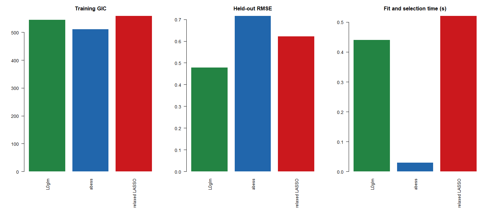

# QSAR: L0glm, abess and relaxed LASSO

Run `benchmark L0glm vs abess and relaxed LASSO.R` from the repository root,
the package directory, or this benchmark directory. It loads the checkout with
`pkgload::load_all(..., compile=FALSE)`; use `library(L0glm)` instead to benchmark
an installed version.

The example compares three practical fits on the original seed-1 stratified
split: 242 training and 80 held-out molecules, with 2,776 descriptors after
training-only near-invariance filtering.

- **L0glm:** `L0glm.fit(..., family=gaussian(), lambda="gic", intercept=TRUE,
  nonnegative=FALSE)`. Default `normalize="auto"` and `start=NULL` handle
  preprocessing and initialization. For this signed Gaussian model, auto uses
  centered columns with L2 norm `sqrt(n)` and returns coefficients in original units.
- **abess:** its default support path, rescored using the common training GIC.
- **Relaxed LASSO:** its lambda path with relaxation fractions 0, 0.5 and 1,
  selected using the same training GIC. Fraction 0 refits least squares;
  fraction 1 is ordinary LASSO.

All methods have a free intercept and signed slopes. No test outcomes enter
preprocessing, fitting or selection. The common Gaussian score is

$$
GIC=n[\log(2\pi)+1+\log(RSS/n)]
    +\log(p)\log\log(n)\,(k+2),
$$

where `k` counts nonzero slopes and the extra two parameters are the intercept
and variance. Lower GIC and held-out RMSE are better; they need not rank models
in the same order on a particular split.

Three timing repetitions use one thread. Times include fitting and training-GIC
selection, excluding held-out scoring. L0glm uses its preset directly; the
competitors search their paths. Change `repetitions` at the top if needed.

Results are saved in `results_default_options/`: `comparison.csv`, PNG/PDF
comparison plots and local fitted objects in `models.rds` (ignored by Git).
Earlier normalization/start experiments remain in the Git history and their
previous output directory; the current example does not rerun that grid.

Results on 18 October 2026 (median of three runs):

| Method | Slopes | GIC | Held-out RMSE | Seconds |
|---|---:|---:|---:|---:|
| L0glm, GIC preset | 7 | 545.02 | 0.47818 | 0.44 |
| abess, GIC path | 11 | 510.18 | 0.71520 | 0.03 |
| Relaxed LASSO, GIC path | 2 | 558.01 | 0.62235 | 0.52 |

