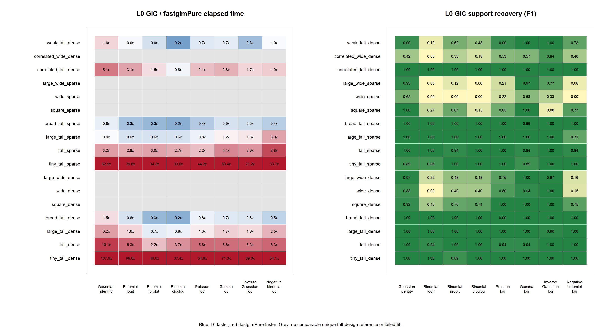
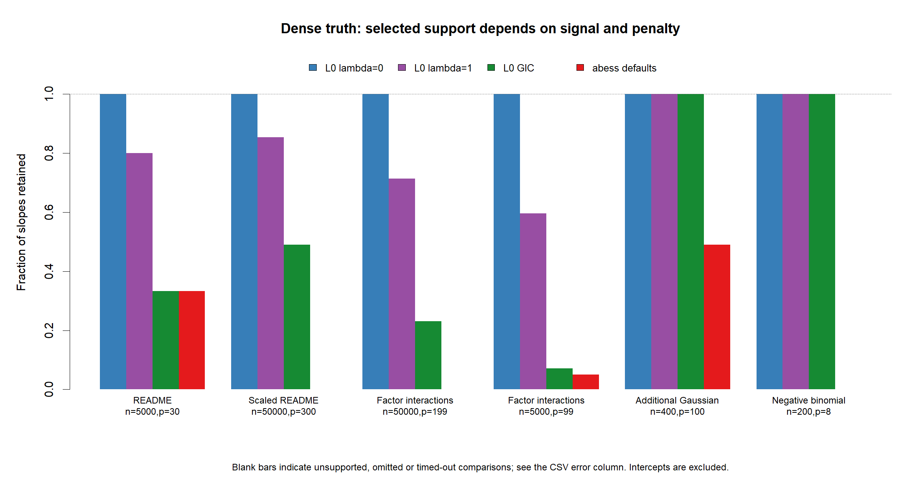

# GLM performance with sparse and dense coefficient truth

These benchmarks compare `fastglm::fastglmPure()` with `L0glm.fit()` on simulated sparse solutions and on the examples in the fastglm README and vignettes. The documented examples also include abess with its default support search and default tuning criterion. Three additional dense Gaussian controls make its default support limit visible; they are explicitly labelled as additional simulations.

Run from the repository root or its `L0glm` package subdirectory:

```r
source("benchmarks/3_benchmark_fastglm_sparse_and_documented/run_sparse_simulations.R")
source("benchmarks/3_benchmark_fastglm_sparse_and_documented/run_documented_examples.R")
source("benchmarks/3_benchmark_fastglm_sparse_and_documented/plot_results.R")
```

From the package subdirectory, prefix those script paths with `../`. Settings, seeds, dimensions and family/link choices are ordinary values in the scripts. No environment-variable configuration is required. The scripts load the checked-out package with `pkgload`; compile it first if its native library is unavailable. Required benchmark packages include `fastglm`, `abess`, `microbenchmark`, `RhpcBLASctl`, `pkgload`, `callr`, `Matrix`, `MASS`, `mgcv` and `statmod`.

## Design and interpretation

The sparse-truth grid has 17 designs and eight family/link combinations: Gaussian identity; binomial logit, probit and complementary log-log; Poisson log; Gamma log; inverse Gaussian log; and negative binomial log with fixed theta 2. Designs include independent and correlated dense predictors, 5% sparse predictors, weak signals, and tall, square and wide systems. Dimensions range from 1,000 by 25 to 50,000 by 300, and from 150 by 600 to 400 by 2,400. Independent test predictors assess error against the true conditional mean.

Two comparisons have different purposes:

* `L0_unpenalized` uses `lambda=0, thresh=0` and is the closest comparison with the unpenalized fastglmPure estimator. It is run only for tall designs.
* `L0_gic` performs adaptive-ridge variable selection at the GIC preset. Its fitting task and selected model differ from fastglmPure's. The documented examples additionally show the package's numeric `lambda=1` default.

Both fitters use `maxit=25, tol=1e-10`, with one BLAS/OpenMP thread. Small simulation fits use three repetitions; large fits use one. The documented-example CSV records its repetition count. Timing excludes data generation and scoring. Abess uses its own default convergence and tuning settings, with one thread, and a 120-second process limit. Unsupported, omitted and timed-out fits remain in the CSV error column. Abess coefficients are extracted at `fit$best.size`, rather than flattening its entire regularisation path.

The wide unpenalized full design does not identify a unique coefficient vector. Dense fastglmPure uses pivoted QR there; sparse Cholesky failures are retained. Such fits are excluded from the timing-ratio figure and their full-design information criteria are left unavailable. `full_design_tall` describes matrix dimensions, not a rank certificate. A finite L0 fit likewise does not establish convergence or a global optimum: inspect the returned diagnostics.

Metrics include support size, F1, MCC, coefficient error, deviance, likelihood, GIC and true-mean prediction error. MCC is undefined when either classification margin is constant, including all-nonzero truth. Prediction floors are `1e-8`; binomial probabilities are also capped at `1-1e-8`. Coefficient error is omitted where a documented fitted model is misspecified or true coefficients are unavailable. GIC comparisons use a common likelihood/scoring convention within each case; they are not certificates of global optimality.

## Implemented performance changes and validation

The baseline is repository commit `8fec71b`. Two subsequent changes are measured separately:

* `309d111` avoids repeated active-column copies for normalized dense predictions when more than half of the coefficients remain active. Restricted-domain links keep the previous calculation: the difficult Gamma square-root example is too sensitive to altered summation order to include safely in this optimization.
* `0302ac7` reuses Gaussian weighted cross-products for normalized dense LLT/LDLT fits with at most 2,000 coefficients and at least that many positive-weight observations. Sparse and wide systems retain their existing routes, including Woodbury solves.

To see why the second change is exact, let `A = sqrt(W) X S^-1` denote the fixed weighted, scaled Gaussian working design, and `r = sqrt(W) (y-offset)`. Each iteration solves

```text
(A' A + D_t) theta = A' r + D_t (S prior.mean),   beta = S^-1 theta.
```

Only the adaptive diagonal `D_t` changes, including any dispersion update. Gaussian identity-link observation weights and the working response remain fixed. The implementation stores `A'A` and `A'r` once, then takes their active-set submatrices. The dense Gram storage is bounded at approximately 32 MB. This changes neither the initialization nor the penalty, threshold, dispersion update, or stopping rule.

All 216 sparse-truth L0 fits and all 80 documented/control L0 fits retain the same selected support and GIC as the baseline. The separate Gaussian cache comparison has maximum relative coefficient difference below `4e-16`; the broader prediction comparison is below `8e-15`. F1 and MCC are unchanged. The full package suite passes 2,705 checks. The earlier regression comparison reruns 36 Gaussian/Poisson deconvolution fits and seven usable QSAR configurations; their coefficients and scores match exactly. Two native Poisson results are retained from the earlier run because the native implementation is unchanged; the validation CSV marks them explicitly. The known unstable unnormalized QSAR `start=1` configuration is excluded, and its code path is unchanged.

Performance improvements vary with matrix size and the number of active iterations. The Gaussian grid shows gains up to about 1.7 times, with smaller gains in short fits. Many non-Gaussian fits still require substantially more work than fastglmPure because adaptive selection runs additional iterations. The CSVs retain slower cases rather than presenting only favorable timings. The installed fastglmPure version used here also returns standard errors and an unscaled covariance matrix; it should not be described as a coefficients-only implementation.

The new grid also exposes existing convergence limits: 79 of 216 L0 fits stop without convergence at `maxit=25`. In particular, one tall sparse negative-binomial example has very poor predictions. These failures remain visible and are not repaired by a timing optimization. The difficult Gamma square-root-link example likewise remains an algorithmic stability limitation. See `convergence_diagnostics.csv` for extra-iteration and fitted-start checks; fitted-start timings exclude the separately computed initializer and are diagnostic rather than end-to-end comparisons.

In that negative-binomial example, `maxit=100` resolves the problem: the GIC fit converges after 73 iterations, selects exactly the 12 true features, and reduces independent true-mean RMSE from about `4.75e37` to `0.853`. Starting from the separately fitted unpenalized model reaches the same selected support in 18 iterations. This points to an initialization/IRLS trajectory problem rather than a different likelihood. A better bounded initializer or a line search for the frozen ridge subproblem deserves a separate investigation before changing defaults. More iterations alone do not resolve every case: the broad unpenalized complementary-log-log fit still does not converge after 100 iterations.



## Dense truth and the abess support limit

Dense truth does not imply that an information criterion should retain every effect. In the README's 5,000 by 30 weak-effect binomial example, the GIC fits select 10 slopes; abess's search already reaches all 30, so its support cap is not binding. The numeric `lambda=1` L0glm fit retains 24 and the unpenalized fit retains 30.

For the three additional 400 by 100 Gaussian controls, every coefficient has magnitude between 0.3 and 0.6 and noise SD is 0.3. All three L0glm settings retain all 100 slopes in every seed. Abess's actual default search reaches only 49 and selects 49. Its true-mean prediction RMSE is about 2.04–2.13, versus 0.145–0.156 for L0glm at the GIC preset. These are errors on the training predictors against their noise-free means, not independent test errors. This comparison diagnoses the default search restriction, not a defect in the abess optimizer; changing its support search would be a different benchmark.



## Documented example sources

The scripts record a source URL and any adaptation for each case:

* [fastglm README](https://github.com/jaredhuling/fastglm/blob/master/README.Rmd): weak dense binomial coefficients and the sparse-signal speed example.
* [Overview](https://github.com/jaredhuling/fastglm/blob/master/vignettes/fastglm-overview.Rmd): Poisson and grouped-binomial esoph examples.
* [Benchmarks vignette](https://github.com/jaredhuling/fastglm/blob/master/vignettes/benchmarks-fastglm.Rmd): sample-size scaling and one-hot factor interactions.
* [Large-data vignette](https://github.com/jaredhuling/fastglm/blob/master/vignettes/large-data-fastglm.Rmd): factor, dense, streaming-data generator, weights and offsets. This benchmark uses full matrices; it does not claim to test L0glm streaming interfaces.
* [Stability vignette](https://github.com/jaredhuling/fastglm/blob/master/vignettes/fastglm.Rmd): the challenging Gamma square-root-link example.
* [Negative-binomial vignette](https://github.com/jaredhuling/fastglm/blob/master/vignettes/nb-convergence-fastglm.Rmd): its first challenging replicate, with theta fixed at 1 for the matched fastglmPure comparison.
* [abess interface documentation](https://github.com/abess-team/abess/blob/master/R-package/R/abess.R): default support search and selected-model extraction.

The Poisson overview omits a true +1 intercept from its fitted design; both that version and an explicitly corrected-intercept version are included. The esoph response uses the equivalent proportions-plus-trial-weights representation. The sample-size vignette's seed is reset per case, so later cases reproduce its generator and dimensions rather than its full sequential random-number stream. Firth, hurdle and zero-inflated models are different likelihoods and are outside this ordinary-GLM comparison.
